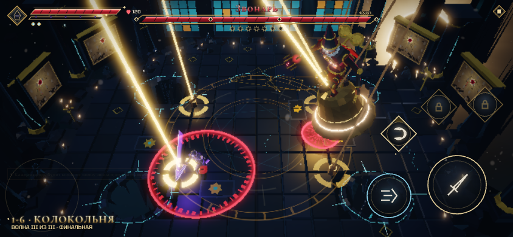
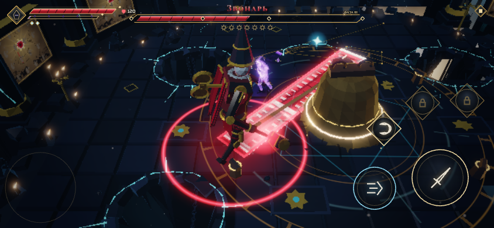

# Звонарь: «Маятник — срежь опоры»

Над Колокольней висит **Великий колокол** на четырёх верёвках. Каждая верёвка идёт от ярма колокола вверх, к блоку
над провалом в полу, и вниз — к железной тумбе у кромки провала. Звонарь едет на маковке колокола, колокол качается
через весь зал, как маятник. Концепция выбрана из трёх вариантов.

Отзыв после проверки второй версии:

- Звонарь слишком лёгкий: его быстро и легко скинуть, обрубив верёвку.
- Его часто оглушают.
- От колокола легко уворачиваться.
- На модели не должно быть колокола на спине. Модель нужна интересная и не совсем обычная.

Третья версия переделывает рубку, оглушения, колокол и модель. Новая модель — **жакемар**, заводная фигура
башенных часов. Её выбрали из трёх вариантов.

## Что было не так

- **Один удар по натянутой тумбе перерубал верёвку.** Если Звонарь ехал на колоколе, рывок сбрасывал его на пол и
  оглушал на 3 с. Четыре верёвки давали четыре бесплатных окна.
- **Оглушений было много:**
  - каждая перерубленная верёвка;
  - падение колокола;
  - идеальный уход от колокола: колокол бил от имени Звонаря, и уход копил ему оглушение;
  - полный заряд в спину звонил в горб: +30 оглушения.
- **Колокол было легко читать:**
  - пауза на краю 1.25 с, проход 1.0 с;
  - полоса всегда шла через центр зала, после первой верёвки — поперёк;
  - на круге кольцо было одно (5.2 м), направление не менялось, остановка длилась 2.3 с;
  - безопасное место не менялось весь бой.
- **Бот с рывками выигрывал все бои.** В прогонах с засеянным `Math.random` он побеждал 6 раз из 6 за 58–76 с, у
  героя оставалось 74–113 HP из 120.

## Правило рубки

**Натянутая верёвка горит золотом — рубить можно только её. В верёвке четыре пряди.**

- **Сколько прядей рвёт удар.** Лёгкий удар — одну, тяжёлый приём — две: Разлом, Звездопад, Крест, Контрудар,
  заряженный удар. Способность, задевшая тумбу, рвёт одну прядь.
- **Огни у тумбы** показывают, сколько прядей осталось. У натянутой верёвки огни горят и пульсируют, у провисшей
  тлеют. Порванная прядь вспыхивает на верёвке.
- **Волна звона.** Каждая порванная прядь будит колокол: от него по всему залу идёт волна звона. Её проходят
  рывком, она снимает 10 % HP. Волна идёт не чаще раза в 0.55 с, поэтому серия ударов вызывает одну волну.
- **Ослабленная верёвка не рубится.** Тумба звенит и сыплет искрами.
- **Рывок срезанной верёвки.** Колокол дёргается и через 0.6 с идёт через зал к её тумбе, туда, где стоит рубивший.
  Полоса этого прохода белая. Остальные верёвки провисают на 4.5 с.

Верёвка натянута, когда колокол дальше всего от её блока: на краю качания и на противоположной стороне круга. Значит,
рубить нужно с той стороны зала, куда колокол сейчас не смотрит. На паузе 0.9 с серия из четырёх лёгких ударов
успевает, если начать её сразу. Иначе за верёвкой придётся вернуться на следующей паузе.

## Фазы по верёвкам

Фаза зависит от числа целых верёвок, а не от HP.

| Верёвок | Фаза | Колокол | Звонарь |
| --- | --- | --- | --- |
| 4–3 | I, маятник | Пауза на краю 0.9 с, проход 0.85 с. Первые два прохода идут через центр, потом каждая новая полоса повёрнута на 17–43° в случайную сторону. | Едет на маковке, недосягаем. Пинает колокол обратно той же полосой: пауза 0.5 с, белая метка; шанс 30 %, после первой верёвки 50 %. Спрыгивает на героя: метка 1.15 с, окно наказания 1.1 с. Герой у натянутой тумбы — прыгает защищать её с шансом 70 %. |
| 2–1 | II, круг | Кольца по очереди: дальнее 6.4 м и ближнее 4.2 м. Направление меняется каждую раскрутку. Метка 0.95 с, раскрутка 2.1 с, остановка 1.7 с — напротив целой верёвки. С шансом 35 % колокол без остановки идёт на второй круг после метки 0.65 с. | Прыгает в центр зала прямо с маковки (метка 1.1 с) и крутит колокол вокруг себя. На остановке бьёт вокруг себя или хлещет верёвкой по линии. Пока колокол кружит, хлещет героя за кольцом, не чаще раза в 5 с. |
| 0 | III, язык | Срывается в центр: белая метка 1.25 с, удар по кругу 3 м. Лежит как укрытие. | Отскакивает от центра без оглушения, ждёт, пока колокол ляжет, и вырывает язык. Бьёт языком-молотом. Новые атаки: **кистень** — язык на верёвке описывает круг 2.4–6.2 м вокруг него, у ног безопасно; **бросок** — язык летит по линии 9.5 м и рывком возвращается той же линией (красная метка — бросок, белая — возврат). Бегает в 1.2 раза быстрее, передышка между атаками 0.25–0.6 с. |

**Рывок верёвки бьёт по Звонарю:** каждая перерубленная верёвка снимает 10 % его HP.

**Пороги HP.** Пока целы 3–4 верёвки, клинок не опустит Звонаря ниже 60 % HP; пока целы 1–2 — ниже 30 %. Удар в порог
уходит в колокол: золотая рябь и подсказка «Колокол держит Звонаря — сначала руби верёвки». На полосе HP порогам
соответствуют два ромба. Убить Звонаря можно только в III фазе.

## Оглушения

- **Перерубленная верёвка не оглушает и не сбрасывает.** Звонарь удерживается на маковке и ревёт, а колокол сам идёт
  на рубившего. На полу он только вздрагивает.
- **Падение колокола не оглушает.** Звонарь отскакивает и выпрямляется за 0.45 с.
- **Уход от колокола и от волны звона не копит Звонарю оглушение.** Это удары колокола, а не его. Для героя
  идеальный уход засчитывается как обычно. Уход от собственных ударов Звонаря по-прежнему копит ему оглушение.
- **Удара в горб больше нет:** нет горба.
- **Шкала оглушения:** порог 90 → 120, оглушение 3 → 2.5 с. Привыкание между фазами больше не сбрасывается: каждое
  следующее оглушение требует на 30 % больше, до ×1.9.
- **Окна наказания после атак короче:** 0.8–1.1 с вместо 1.0–1.6 с.

## Колокол бьёт всех

Колокол на проходе бьёт героя (20 % HP героя зоны, сильный отброс) и всех врагов на пути. Во II фазе на колокольню
лезет Шелуха (8), кружащий колокол её сметает.

## Модель: жакемар

Жакемар — механическая фигура башенных часов, которая отбивает часы молотом по колоколу. Звонарь веками бил в
Великий колокол и сам стал частью механизма.

- **Колпак-шпиль.** Высокий восьмигранный шатёр, как крыша колокольни, чуть откинут назад. На нём латунные обручи,
  шар и флюгер-стрела. Сверху колпак — главный признак силуэта.
- **Фарфоровая маска** с нарисованными румянцем и улыбкой. Через маску идёт трещина, в глубине тлеет огонь, огонь
  горит и в глазницах. Под маской — гофрированные брыжи.
- **Циферблат на груди:** слоновая кость, латунный ободок, тлеющий зазор, часовые метки. Стрелки идут сами, в III
  фазе вдвое быстрее.
- **Маятник в окошке живота.** Качается сам и отстаёт от рывков тела.
- **Заводной ключ на спине** вместо колокола: латунная «бабочка» из двух колец. Ключ крутится медленно на ходу,
  быстрее на колоколе и в атаке. **Перед прыжком он раскручивается** — это подсказка. В оглушении замирает.
- **Тело.** Тёмное лакированное дерево на латунных шарнирах в плечах, локтях, бёдрах и коленях. Ливрея — выцветшая
  красная с золотом: пышные рукава, юбка-табард, рваные полосы по спине. Полосатые чулки, туфли с загнутыми носами,
  латунные гири часов на бёдрах.
- **Руки.** Левая — латунные пальцы-когти. Правая держит молот жакемара: деревянная рукоять, железная голова поперёк,
  латунные обручи и бойки, тлеющие трещины от ударов.
- **Движение.** Ноги чуть согнуты, в покое голова поворачивается рывками то влево, то вправо, как у часовой фигуры.
  Стопы стоят на полу, а на колоколе — на маковке.
- **III фаза.** Гиря языка Великого колокола надевается на голову молота. При броске она летит на верёвке.

Суставы у скелета называются так же, как у тяжёлых стражей: позы, походка и постановка добивания работают без
перевода. Добавлены суставы `key` (ключ), `pend` (маятник), `hourH` и `minH` (стрелки).

## Добивание

Последний удар по оглушённому Звонарю запускает kill-cam:

1. Жакемар встаёт на колени лицом к герою, корпус прямой.
2. Герой прыгает и вонзает клинок в циферблат.
3. Корпус отбрасывает назад, ключ дёргается.
4. Через 90 мс циферблат лопается: надтреснутый бой часов, из груди сыплются шестерни и искры.
5. Фигура оседает вперёд: кончился завод.

Точка удара на модели и в сцене одна: центр циферблата.

Проверки сцены (`npm run finishers`, `killBell`) проходят на 844×390, 740×360 и 1280×720.

## Подсказки и звук

- **Первая езда на колоколе:** «Колокол замирает на краю — руби золотую верёвку у тумбы: в ней четыре пряди».
- **Первая порванная прядь:** «Каждая прядь будит колокол: волну звона проходи рывком».
- **Прядь:** золотые искры, щелчок; с каждой прядью щелчок выше.
- **Волна звона:** гул колокола и золотая вспышка на нём.
- **Пинок колокола:** звон маковки и свист.
- **Перерубленная верёвка:** золотые искры, щелчок, гул колокола, надпись «ВЕРЁВКА · ОСТАЛОСЬ N».
- **Падение колокола:** удар по всему залу, бронзовая крошка, кольцо пыли.

## Баланс

Бот `scripts/bellBot.mjs` играет задуманным способом:

- уходит с полосы прохода и кольца;
- бежит к тумбе натянутой верёвки и рубит пряди;
- волну звона проходит рывком навстречу;
- бьёт Звонаря на полу.

Герой — 120 HP, без улучшений. `Math.random` засеян, темп Пилота новый.

| Версия | Бот | Прогонов | Победы | Время победы | HP героя в конце |
| --- | --- | --- | --- | --- | --- |
| II | с рывками | 6 | 6 | 58–76 с | 74–113 |
| III | с рывками | 12 | 7 | 75–122 с | 5–120 |
| III | без рывков | 3 | 0 | гибель на 24–79 с | — |

В проигранных боях III версии бот трижды из пяти доходил до III фазы, один раз у Звонаря оставался 1 % HP. Больше
всего урона бот получает:

- от ударов Звонаря на полу, раньше их гасило оглушение;
- от его прыжков у тумб;
- от хлёста верёвкой во II фазе.

## Как открыть и проверить

- `?stage=1-6&wave=2` — сразу к Звонарю; `?watch=killBell` — добивание.
- Тесты механики — `tests/enemies3.test.ts`:
  - раскладка верёвок и четыре пряди;
  - прядь и волна звона, тяжёлый приём, перерубленная верёвка без оглушения;
  - провисание после рывка, поворот полосы, пинок колокола;
  - прыжок в защиту опоры, уход от колокола без оглушения, пороги HP;
  - два кольца и смена направления, хлёст за кольцом;
  - падение без оглушения, бросок и кистень;
  - модель-жакемар: суставы ключа, маятника и стрелок, точка добивания на циферблате, ключ перед прыжком.
- Браузер: `npm run finishers` (добивание `killBell`).

## Где в коде

- [Колокол: пряди, волна звона, качание, пинок, рывок, круг, падение](../src/world/boss/greatBell.ts) — константы
  `GREAT_BELL`, `HEAVY_CUTS`.
- [Звонарь: езда, прыжки, фазы, приёмы](../src/world/boss/guardians.ts) — константы `RINGER`, `CLAPPER_REACH`;
  механизм модели (ключ, стрелки, маятник, «тик») — `RINGER_STANCE`, `shapePose`.
- [Вид колокола, верёвок, огней прядей и броска языка](../src/vfx/greatBellView.ts) — `BELL_LOOK`.
- [Модель и скелет жакемара](../src/gen/chars/ringer.ts) — `ringerRig`, `buildRinger`, циферблат `RINGER_DIAL`, точка
  удара `RINGER_CONTACT`.
- [Позы добивания](../src/world/boss/guardianStaging.ts) — `ringerKneel` и реакция; сцена — `killBellTrack` в
  [guardianScenes.ts](../src/world/boss/guardianScenes.ts).
- Звук и эффекты — `greatBellFeel` в [feel.ts](../src/game/feel.ts).
