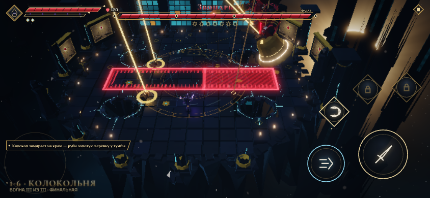
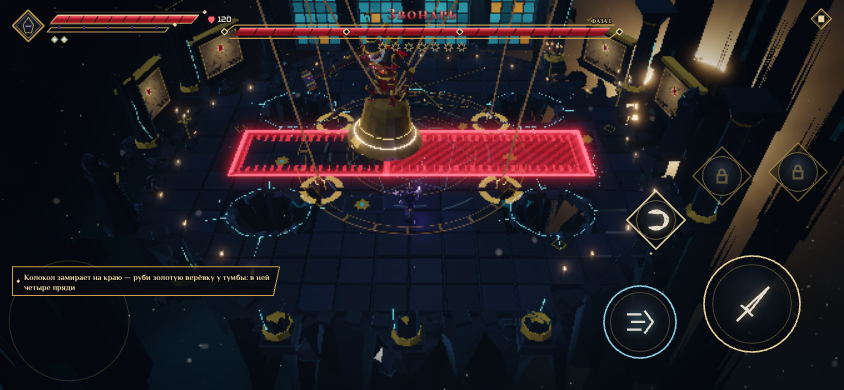
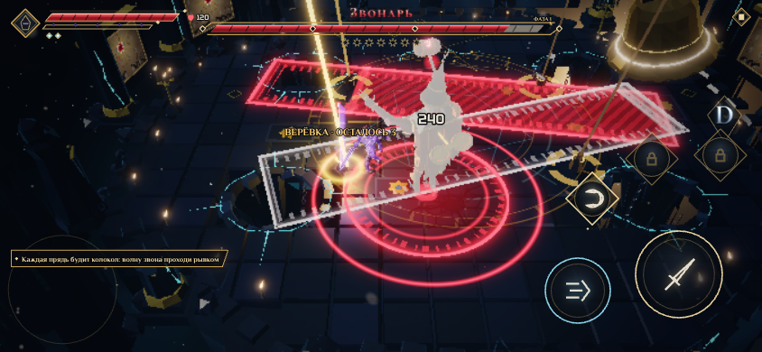
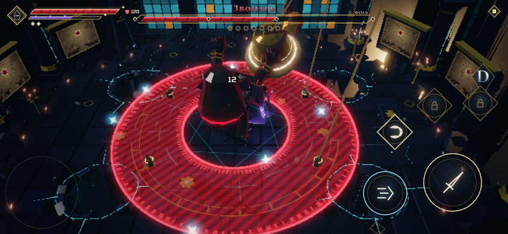
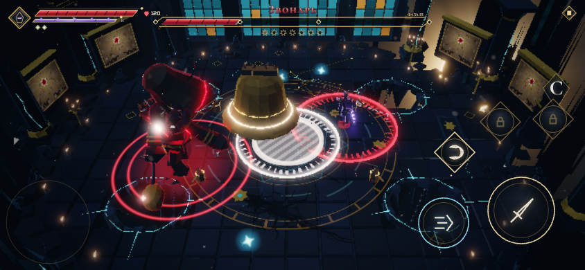
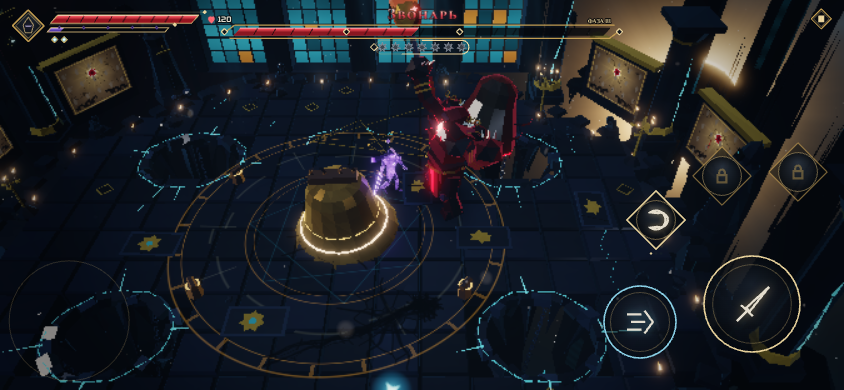
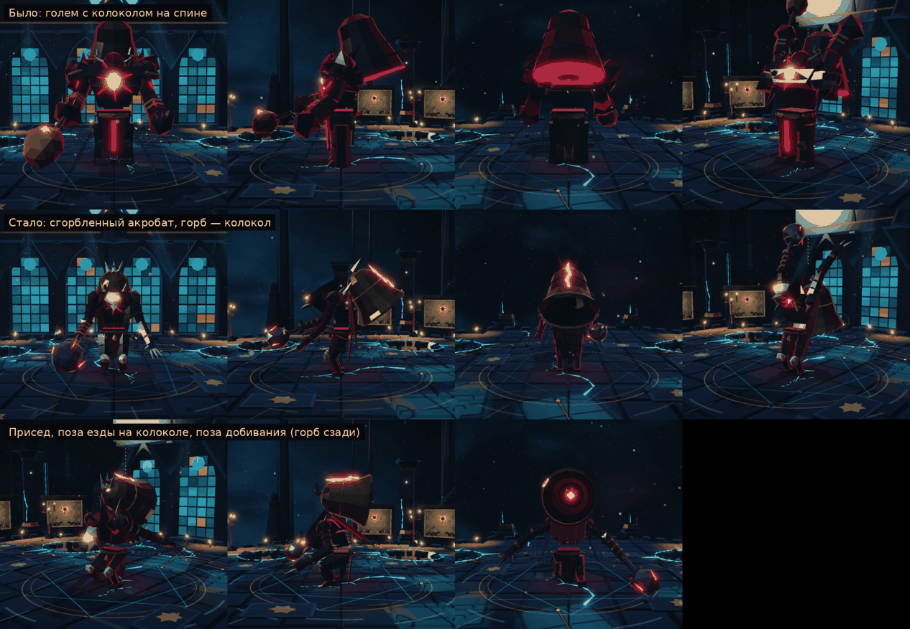
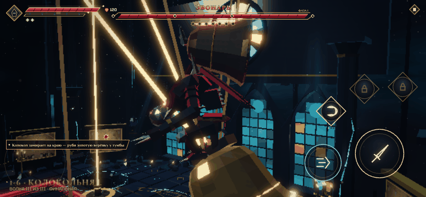
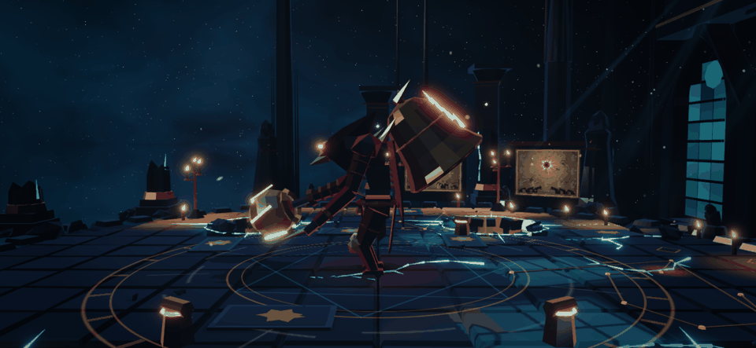
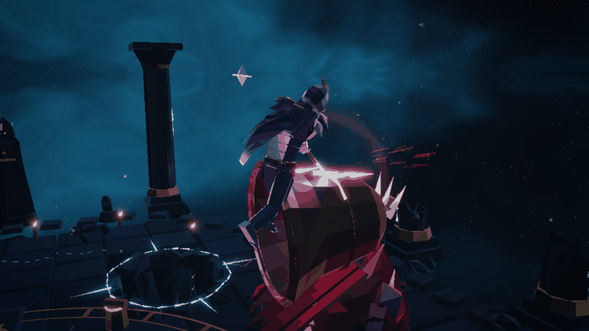

# Звонарь: «Маятник — срежь опоры»

Отзыв: прежняя концепция Звонаря не нравилась. Он стоял на месте и звонил в колокол на спине: кольца, цепи, такт. Бой
решался реакцией на кольца, а не решениями игрока. Новая концепция выбрана из трёх вариантов: **Маятник**.

Звонарь — сгорбленный акробат, сросшийся с колоколом. Над Колокольней висит **Великий колокол** на четырёх верёвках.
Каждая верёвка идёт от ярма колокола вверх, к блоку над провалом в полу, и вниз — к железной тумбе у кромки провала.
Звонарь едет на маковке колокола. Колокол качается, как маятник, через весь зал.

## Одно правило

**Натянутая верёвка горит золотом — один удар по её тумбе перерубает её.**

Верёвка натягивается, когда колокол дальше всего от её блока: на краю качания и на противоположной стороне круга.
Значит, рубить нужно с той стороны зала, куда колокол сейчас **не** смотрит. Через секунду колокол пойдёт обратно —
прямо через тебя.

Удар по ослабленной верёвке не рубит её: тумба звенит и сыплет искрами. После перерубленной верёвки остальные
провисают на 5.5 с: колокол дёрнулся, и следующую сразу не срубить. Это время, чтобы бить Звонаря.

## Фазы по верёвкам

Фаза зависит от числа целых верёвок, а не от HP.

| Верёвок | Фаза | Колокол | Звонарь |
| --- | --- | --- | --- |
| 4–3 | I, маятник | Качается от края до края. На краю замирает на 1.25 с, полоса следующего прохода горит всю паузу и весь проход. После первой перерубленной верёвки качание поворачивает поперёк зала. | Едет на маковке, недосягаем. На паузе спрыгивает на героя: метка 1.2 с, удар, окно наказания 1.6 с. Если герой бежит к тумбе натянутой верёвки, Звонарь может прыгнуть сразу, защищая опору. На полу — размах, выпад или топот, затем на следующей паузе вскакивает обратно. Колокол ждёт его на краю. |
| 2–1 | II, круг | Звонарь раскручивает его вокруг себя на 5.2 м: кольцо горит 1.25 с до раскрутки и всю раскрутку. Остановка 2.3 с — всегда напротив целой верёвки, она натянута. | Прыгает в центр зала (метка 1.1 с), ревёт и становится осью кистеня. Бьёт только на остановке колокола: круговой взмах (метка 1.2 с) или хлёст верёвкой по линии. Пока колокол крутится, он крутит и не бьёт. |
| 0 | III, язык | Срывается в центр зала: белая метка 1.25 с, удар по кругу 3 м. Лежит как укрытие с трещиной. | Отскакивает от центра, удар колокола о пол сбивает его с ног (оглушение). Встаёт, вырывает язык колокола и бьёт им как молотом: удар впереди, двойной удар с разворотом, размах, прыжок. Между атаками — короче передышка. |

**Рывок верёвки бьёт по Звонарю:** каждая перерубленная верёвка снимает 10 % его HP. Если он ехал на колоколе, его
сбрасывает на пол и оглушает. Если стоял на полу — дёргает на колено на 0.9 с.

**Пороги HP.** Пока целы 3–4 верёвки, клинок не опустит Звонаря ниже 60 % HP; пока целы 1–2 — ниже 30 %. Удар в порог
уходит в колокол: золотая рябь и подсказка «Колокол держит Звонаря — сначала руби верёвки». На полосе HP порогам
соответствуют два ромба. Убить Звонаря можно только в III фазе.

## Колокол бьёт всех

Колокол на проходе бьёт героя (20 % HP героя зоны, сильный отброс) и всех врагов на пути. Во II фазе на колокольню
лезет Шелуха (8), и кружащий колокол сметает её. Удар колокола засчитывается как атака Стража: идеальный уход от него
даёт «Мгновение Пустоты» и оглушение. Если Звонарь в этот момент едет на колоколе, он падает с маковки.

## Модель

Отзыв: после переделки боя модель осталась прежней — тяжёлый голем Стража Врат с большим колоколом на спине. Теперь
у Звонаря своя модель и свой скелет: **сгорбленный акробат, сросшийся с колоколом**.

- **Горб — малый колокол, вросший в хребет.** Маковка выше головы, раструб смотрит назад и вниз, сквозь маковку
  торчат позвонки. По спинке горба идёт тлеющая трещина. Внутри раструба тлеет маленькое сердце, а не диск во весь
  раструб, как раньше. Горб из тёмной бронзы, Великий колокол — золотой: рядом они не путаются.
- **Голова низко и впереди корпуса.** Костяная маска с горящей прорезью, клюв-челюсть, острый капюшон, открытый
  спереди.
- **Длинные руки, до колен.** Левая — с тремя костяными когтями. Правая срослась с языком колокола: плоть переходит
  в железный стержень с бронзовыми кольцами, вместо кисти — чугунная гиря с горящими трещинами.
- **Тонкие длинные ноги** с цепкими стопами, на поясе канат, обрывки рясы и бубенцы, с плеч по спине — рваный плащ.
- **Стойка — полуприсед.** В покое и на ходу ноги согнуты, шаг длиннее и легче, чем у каменного Стража.
- **Стопы всегда на опоре.** В присядах и прыжковых позах тело опускается так, чтобы стопы стояли на полу, а на
  колоколе — на маковке. Раньше в присяде страж висел над полом.
- **Горб качается.** Он отстаёт от рывков тела и вздрагивает при приземлении.
- **III фаза.** Вырванная гиря языка Великого колокола надевается на сросшуюся с рукой гирю, та становится огромной
  и тлеет трещинами. Раньше в руке появлялась вторая гиря дальше по руке.

Суставы у нового скелета называются так же, как у тяжёлых стражей: позы, походка и постановка добивания работают
без перевода. Пропорции свои: плечи уже, руки длиннее, голова ниже плеч и впереди.

## Добивание

Последний удар по оглушённому Звонарю запускает kill-cam, а удар героя приходится **в трещину горба-колокола**, как и
было в концепции. Сцена строится от нового скелета: точка удара на модели и в сцене одна и та же. Проверки сцены
(`npm run finishers`, `killBell`) проходят на 844×390, 740×360 и 1280×720. Полный заряженный удар в спину
по-прежнему звонит в горб: кольцо силы героя и +30 оглушения.

## Подсказки и звук

- Первая езда на колоколе: «Колокол замирает на краю — руби золотую верёвку у тумбы».
- Перерубленная верёвка: золотые искры, щелчок, гул колокола, надпись «ВЕРЁВКА · ОСТАЛОСЬ N».
- Проход и раскрутка: тяжёлый свист и низкий удар колокола.
- Падение колокола: удар по всему залу, бронзовая крошка, кольцо пыли.

## Баланс

Бот `scripts/bellBot.mjs` играет задуманным способом. Он уходит с полосы прохода и кольца, бежит к тумбе натянутой
верёвки, рубит её, бьёт Звонаря на полу. Герой — 120 HP, без улучшений.

| Бот | Прогонов | Победы | Время боя | HP героя в конце |
| --- | --- | --- | --- | --- |
| С рывками из меток | 6 | 6 | 48–74 с | 24–76 |
| Без рывков | 3 | 0 | гибель на 40 с, в III фазе | — |

Сам колокол бота с рывками почти не бьёт: за прогон — не больше одного удара. Опасность III фазы — язык-молот.

## Как открыть и проверить

- `?stage=1-6&wave=2` — сразу к Звонарю; `?watch=killBell` — добивание.
- Тесты механики: `tests/enemies3.test.ts` — раскладка верёвок, езда, натянутые верёвки, рубка и звон тумбы,
  провисание после рывка, пороги HP, круг и остановки, падение и язык, удар колокола по герою и Шелухе, прыжок
  в защиту опоры, срезанная верёвка во время прыжка на колокол.
- Браузер: `npm run finishers` (добивание `killBell`), `node scripts/sweep.mjs 1-6`.

## Где в коде

- [Колокол: верёвки, качание, круг, падение, удар](../src/world/boss/greatBell.ts) — константы `GREAT_BELL`.
- [Звонарь: езда, прыжки, фазы, приёмы](../src/world/boss/guardians.ts) — константы `RINGER`.
- [Вид колокола, верёвок и тумб](../src/vfx/greatBellView.ts) — `BELL_LOOK`.
- [Модель и скелет Звонаря](../src/gen/chars/ringer.ts) — `ringerRig`, `buildRinger`, горб `RINGER_HUMP`, точка
  удара `BELL_CONTACT`; стойка и качание горба — `RINGER_STANCE` в [guardians.ts](../src/world/boss/guardians.ts).
- Звук и эффекты — `greatBellFeel` в [feel.ts](../src/game/feel.ts); подкрепление II фазы — триггер `guardianPhase2`
  в [stages.ts](../src/data/stages.ts).
