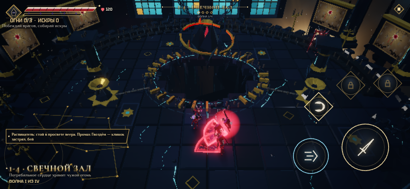
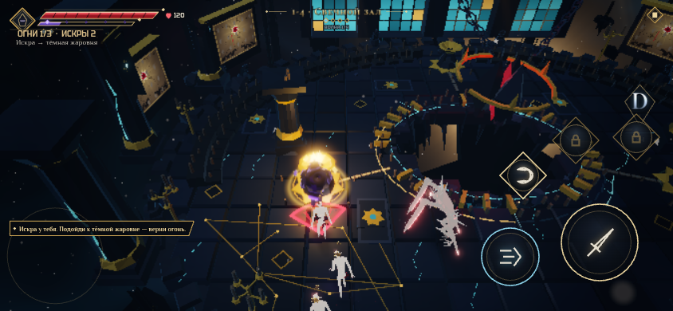
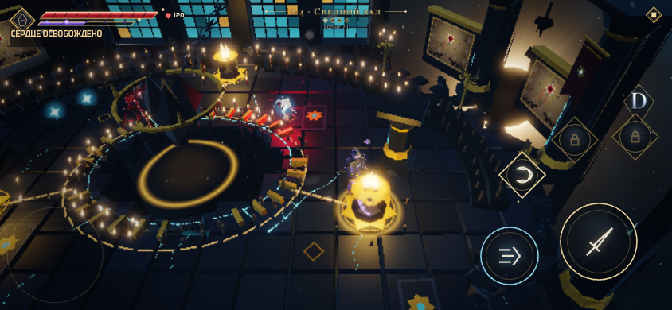
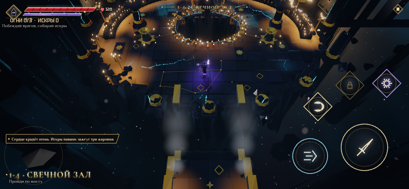

# Свечной зал: Погребальное сердце

Убрана подсказка «Врата открыты. Пройди по золотым меткам». После входа в Свечной зал мост распадается по десяти рядам за 2.5 секунды: падают настоящие плиты, перила и опоры, появляются пыль и обломки. Разрыв остаётся после победы; навигация видит пропасть. Герой сохраняет управление, камера плавно отдаляется и показывает обвал. Первые враги появляются после разрушения; ожидание не ухудшает оценку боя. Переход не требует склейки или отдельной сцены. Невидимая преграда и световая печать на мосту удалены.

В центре зала над колодцем висит Погребальное сердце в сломанном венце и цепях. Свечи хранят тепло умерших; сердце забирает их огонь, чтобы ударять по живым. Три жаровни связаны с ним восковыми каналами. Лор и вступление обновлены под эту механику.

## Как работает ритуал

1. При входе сердце один раз поглощает свет полным кругом за 2.2 секунды. Пламя и его световые пятна действительно достигают нулевой яркости; угол замыкания круга также проверяется.
2. Побеждённые враги дают искры. Можно нести до трёх — они видны золотыми огнями возле героя.
3. С искрой нужно подойти к незажжённой жаровне на 2.2 метра. Через 0.6 секунды она загорается, расходуя одну искру. Можно продолжать бой рядом с ней; отдельная кнопка не нужна. Розжиг работает и между волнами.
4. Жаровня навсегда возвращает свет своему сектору, добавляет 25 Резонанса и выпускает удар по врагам в радиусе 7 метров: урон 1.2× и 45 единиц оглушения.
5. Каждые 12 игровых секунд сердце посылает импульс. За 2.2 секунды до него краснеют линии тёмных секторов и звучит предупреждение. Светлый сектор защищает. В темноте удар использует обычные правила урона, брони и уклонения; исходный урон — 10% максимального HP.
6. Третья жаровня разбивает сердце и освобождает весь огонь до конца боя. Разрушение видно на модели, а импульсы прекращаются. Смена волн ничего не сбрасывает и сама свечи не зажигает.

Ритуал помогает, но не блокирует прохождение: можно победить врагов без решения, и завершение боя тоже освобождает похищенный свет. Четыре волны и прежние награды 1-4 сохранены. В паузе игровые часы ритуала и обвала стоят.

## Визуальная доработка

Вместо равномерного свечного поля — ярусы поминальных свечей, восковые русла, три различимые жаровни, венец и парящие части сердца. Золотые линии обозначают возвращённые сектора, багровые — предстоящий импульс. При переносе искр подсвечиваются кольца доступных жаровен. Камера мягко показывает центр зала; компактный счётчик огней и искр не перекрывает бой.

Все обычные свечи используют общий механизм видимости Flames и LightPools. Исправлены прежний предел 86% круга и остаток яркости 12% у световых пятен. Источники на обрушившемся мосту гаснут вместе с опорами и не появляются снова при восстановлении свечей зала. GPU-буферы новых instanced-мешей освобождаются при выходе.

## Воспроизведение

```bash
npm run check
npm run candles-test
npm run cathedral-test
```

Прямой вход: `?stage=1-4`. Полное прохождение с Вратами и обвалом: `?stage=1-3`. `candles-test` проверяет настоящее получение искр, полный круг гашения пламени и световых пятен, урон сердца, защиту светом, розжиг трёх жаровен и сохранённую победу через App. `cathedral-test` проверяет непрерывность перехода, обвал пола, разрыв навигации, безопасность порога и сохранение обеих наград. Ускоренное снятие врагов проверяет состояния, а не баланс сложности.

Проверено: TypeScript, 442 теста в 51 файле, production build; ритуал на medium 844×390 и high 740×360, связанный маршрут на high 844×390. Выборка максимума связанного маршрута: 90 вызовов / 162 528 треугольников при бюджете 160 / 260 000. Сборка — 1 855 232 байта при лимите 2 097 152.

Кадры и результаты: [validation.json](candles/validation.json). Автоматический Chromium/SwiftShader не измеряет время кадра и нагрев физических телефонов; звук в стенде выключен.








