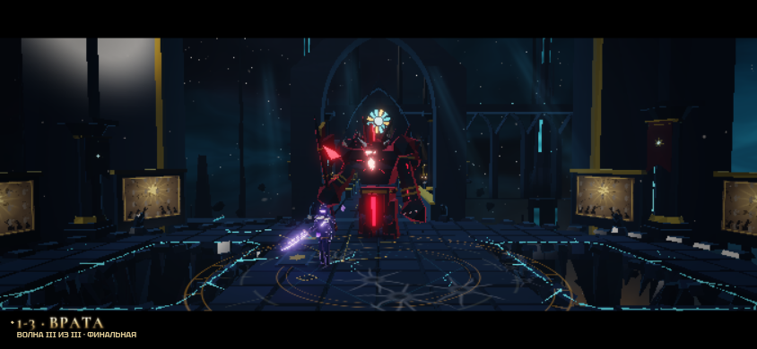
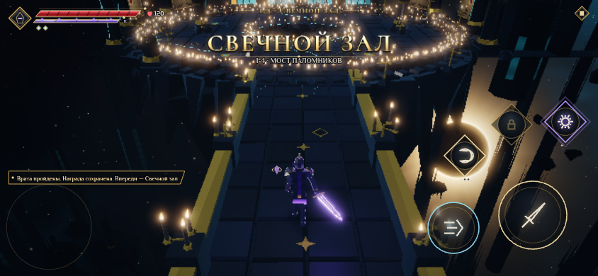
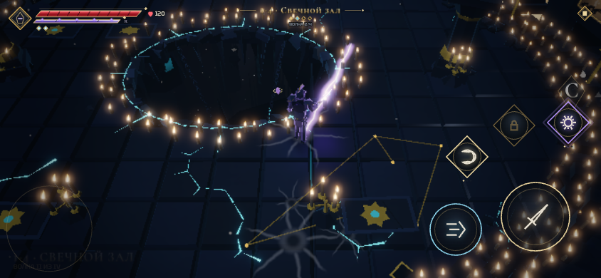

# Врата → мост → Свечной зал

Новая версия локации: [Погребальное сердце и обрушение моста](CANDLE_RITUAL.md). Кадры и цифры ниже относятся к первой версии связанного маршрута.

Этапы 1-3 и 1-4 соединены в один управляемый маршрут. Вход через карту или `?stage=1-3`: галерея, бой у Врат, открытие решётки, мост над пустотой и четыре волны Свечного зала. Мир, герой, камера и система ввода остаются теми же; переход не вызывает экран результатов, загрузку или телепортацию.

На выходе из Врат игра сразу сохраняет их награду и открытые способности. Следующий участок получает отдельные счётчики боя и рейтинг. Здоровье сохраняет текущую долю, новые способности доступны на мосту; время прогулки не снижает оценку. Поражение в следующем зале сохраняет уже полученный прогресс Врат. После зачистки зала появляется обычный экран награды 1-4. Запуск 1-4 с карты остаётся доступен отдельно.

До входа мост имеет непрерывный пол и борта. После входа он обрушивается, оставляя постоянный разрыв пути; невидимой преграды нет. Враги появляются внутри следующего зала. Центральный колодец и укрытия свечной арены сохранены. Новый свет, тени, свечи и световые пятна используют общие системы сцены.

## Исправленные дефекты

- У трёх проходных арок удалены поперечные поверхности на уровне пола: раньше они выглядели как чёрные плиты поперёк пути. Ноги и свод сохранены, центр проверяется трассировкой лучей.
- Вход Стража обновляет положение видимого скелета вместе с игровым актёром при остановленном мире. Раньше актёр перемещался, а модель оставалась у исходной точки.
- Камера входа проходит внутри галереи и учитывает положения обоих персонажей при возврате в бой. Колонна больше не заслоняет Стража; близкий к Вратам герой не притягивает камеру внутрь модели.
- Нейтральные ключи бёдер и коленей заданы явно: согнутая нога будущего шага больше не просачивается в начало и конец входа.

## Проверки и воспроизведение

```bash
npm run check
npm run cathedral-test
# Дополнительно:
CATHEDRAL_Q=medium CATHEDRAL_VIEW=740x360 npm run cathedral-test
npm run gate-path-test
npm run finishers
```

`cathedral-test` проходит обе секции обычными сигналами движения и атаки и ускоренно снимает врагов после 3.5 секунд жизни. Это проверка последовательности, а не баланса сложности. Стенд вызывает реальные обработчики App, проверяет сохранение обоих результатов, единственный checkpoint, отсутствие замены мира/героя/камеры и скачка позиции, положение скелета Стража, ошибки браузера и бюджет рендера. Отчёт и кадры пишутся в `work/cathedral/`. `CATHEDRAL_Q` выбирает качества, `CATHEDRAL_VIEW` — размер кадра, `CATHEDRAL_OUT` — папку результатов. CI запускает medium и сохраняет артефакты.

Отдельный маршрут Врат и его проверки используют `?stage=1-3&single`. Пересмотры добиваний в Кинозале сохраняют исходные арены и не начисляют награды.

Кадры из Chromium, medium, 844×390:







Проверенная сборка: 421 модульный тест в 47 файлах, TypeScript и production build; 81 проверка полного/пропущенного добивания Стража на 844×390, 740×360 и 1280×720. Два этапа пройдены на medium/high 844×390 и medium 740×360. Выборка всех проходов рендера: medium — 67 вызовов / 154 609 треугольников, high — 77 / 170 973 при бюджете 160 / 260 000; это максимум по проверенным кадрам, а не по всем возможным ситуациям.

Результаты автоматических прогонов — в [validation.json](cathedral/validation.json). Они проверяют работу WebGL и объём отрисовки. Время кадра и нагрев на физических телефонах не измерялись; звук в стенде выключен.
