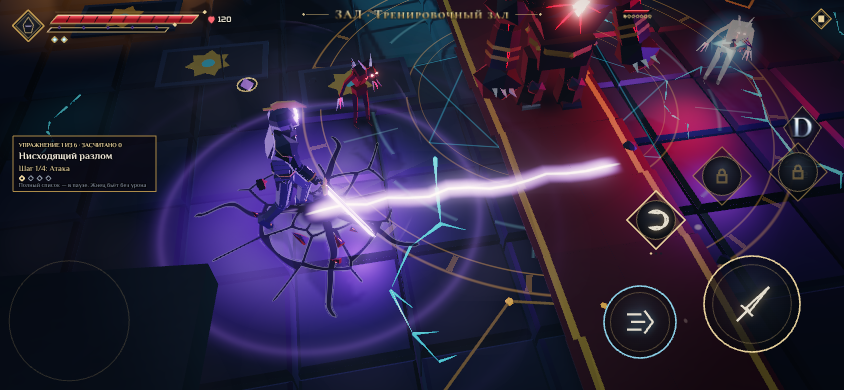
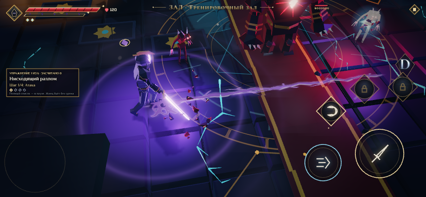
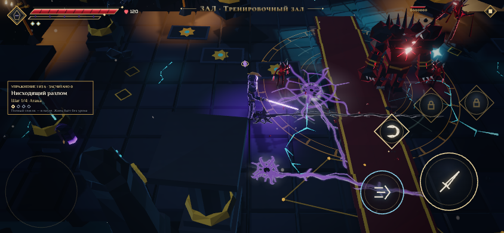
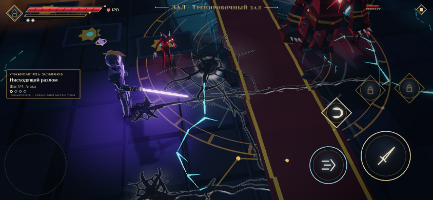

# Трещины от тяжёлых ударов Пилота

Отзыв: трещины и след на полу после тяжёлого удара должны быть круче и реалистичнее, а светиться — слабее.

## Что было

- Полный заряд, Нисходящий разлом и Звездопад рисовали ровную неоновую линию: фиолетовый ореол и белое ядро на 3 с. Это разлом, вдоль которого рывок скользит.
- Под ним лежал плоский бледный след: семь лучей и тёмное пятно, едва заметные (непрозрачность 0.24).

## Как теперь

Тяжёлый удар клинка раскалывает пол (`vfx/scars.ts`, `game/battle.ts → heroCrack`).

**Разлом.** Полный заряд раскалывает пол на всю дальность волны клинка, Нисходящий разлом — на длину удара. Разлом бежит от точки удара вместе с волной (20 и 26 м/с). Главная трещина ломаная, её ширина рвётся: то волосок, то раскрытая щель. К концу она сужается. Вокруг идут ветви, а в точке удара выбит маленький кратер. Над провалом разлом обрывается.

**Кратер Звездопада** (радиус 2.4 м). Выбоина с неровным краем, пять главных лучей и сеть трещин. Сеть строится Вороным в лог-полярных координатах: лучи и дуги колец, как у удара в камень. Плиты вокруг выбоины чуть сдвинуты — соседние куски светлее и темнее. От центра лучами лежит каменная пыль, она оседает за 10 с.

**Рельеф.** Кромка главной трещины, обращённая к ключевому свету, — светлый скол, другая — в тени. Блик прерывистый.

**Жар.** Только у ударов Пилота и только фиолетовый: красный на полу остаётся за врагом. Через 0.22 с белая вспышка удара гаснет, дальше трещина тускло тлеет фиолетовым и за 3 с остывает. Тления хватает, чтобы видеть разлом для скольжения рывком. Остальное время на полу остаются тёмные трещины: 60 с, у босса 150 с.

**Крошка и пыль.** Из точки удара летят обсидиановые осколки и поднимается облако пыли.

| Через 0.45 с после полного заряда | Звездопад и Разлом через 1.2 с |
| --- | --- |
|  |  |

Удары врагов и Раскол оставляют те же кратеры, но без жара.

## Как сделано

- Один буфер экземпляров на 24 следа и два прохода: рельеф (обычное смешивание) и жар (сложение). Это на один вызов отрисовки больше, чем было. Проход жара отбрасывает пиксели следов старше 4 с.
- Трещина задана полем расстояний в метрах. Ширина и сглаживание — в метрах и пикселях (не шире 3 см), поэтому трещина остаётся чёткой линией на любом удалении камеры, без зерна.
- Постоянные значения следа (сид, вид, размеры) передаются во фрагментный шейдер как `flat`. Иначе сид чуть «плывёт» от пикселя к пикселю, а хеш на синусе превращает это в шум по всей трещине.
- Числа — в `HERO_CRACK` (`game/battle.ts`), `SCAR_HEAT` и `SCAR_GLOW` (`vfx/scars.ts`).
- `?fx=cracks` возвращает прежний вид: плоский след и неоновую линию разлома.

## Проверки

- `tests/arenaLife.test.ts`: разлом ложится от точки удара вдоль удара; у рельефа и жара один буфер.
- `tests/depth.test.ts`: полный заряд даёт разлом для рывка и событие трещины на всю дальность волны клинка.
- Кадры сняты в тренировочном зале: настоящий полный заряд, а Звездопад и Разлом — событием. Стенд не в репозитории.
- Время кадра на телефонах не мерилось: стенд — Chromium с SwiftShader.
