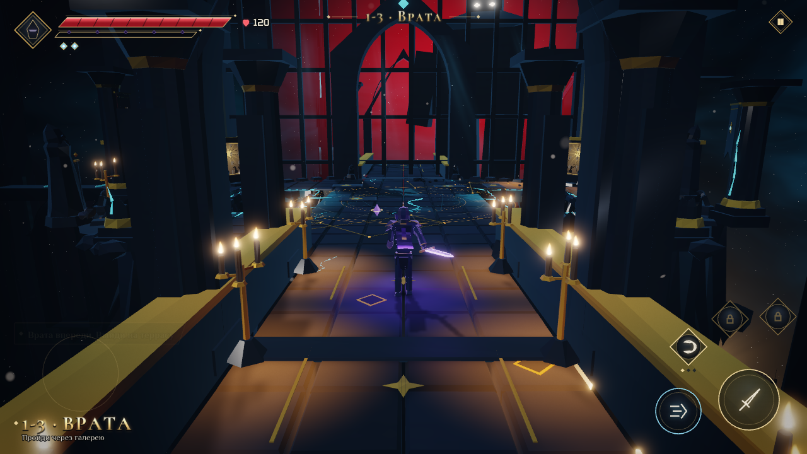
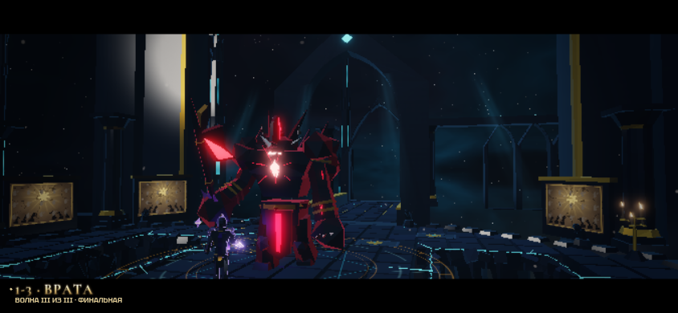
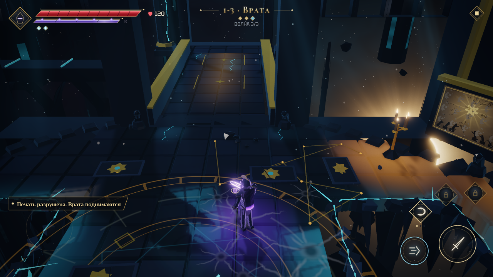

# «Путь к Вратам»: первый фрагмент по визуальному брифу

Продолжение: [непрерывный маршрут через мост в Свечной зал](CATHEDRAL_BRIDGE.md). Обычный запуск 1-3 теперь включает 1-4; ниже описана исходная секция Врат и её отдельный диагностический режим `?stage=1-3&single`.

## Проверенная база

4 ноября 2026 года распакован `voidbreaker-chatgpt-reference-kit.zip`, прочитан `VOIDBREAKER_VISUAL_BRIEF.md` и просмотрены все четыре JPG-листа R01–R16. Это художественные концепты; игровые кадры ниже получены из Chromium.

Работа начата от `f92c4902fffd97d35845212e514a3508aee87956`, ветка PR #6 `claude/new-session-6xsamu`. GitHub и полученные Git refs подтвердили эту цепочку:

| PR | Статус при проверке | HEAD | База |
| --- | --- | --- | --- |
| #1 | открыт | `b4f56845e799ec4cada174de10b5ca6ba3aeea9b` | `main` |
| #4 | открыт, draft | `7b5d1e89db6703bd4e62a86b35aece66c9cd0c04` | #1 |
| #5 | открыт, draft | `8dc893d631127009c9bc42d5141efbd959493fb4` | #4 |
| #6 | открыт | `f92c4902fffd97d35845212e514a3508aee87956` | #5 |

Начальная локальная ветка `work` (`3e46c35e69ec19b7948425f1a8dc640b6e8300a1`) была чистой и отставала на 62 коммита; она сохранена. Новая рабочая ветка — `codex/path-to-gates`. PR #6 включает работу над сценами, студией, анимацией, светом и тенями из предыдущих PR, поэтому реализация опирается на неё.

Отдельная ветка `ccr-d1a4c092-955xsl` (`5902be4112d34727d6bdfca39fb7511c3a066f8b`, 19 октября) содержит независимую аудиоправку из PR #3. Она не является продолжением PR #6. В этом пакете код аудиодвижка не менялся; эту ветку нельзя считать более полной игровой базой по одному номеру или дате PR.

Исходная база прошла `npm run check`: TypeScript, 397 тестов в 43 файлах, сборка.

## Сопоставление с брифом

| Область | Состояние до работы | Проверяемое основание | Результат первого пакета |
| --- | --- | --- | --- |
| Камера | Уже есть cinema/tactical, следование, упреждение, кик, постановочная цель | `src/world/camera.ts`, `Battle.updateCamera` | Контексты исследования/боя/события, мягкая смена наклона, FOV и высоты взгляда. Азимут исследования и боя сохраняется |
| Постановка | Уже есть Director, абсолютные часы клипов, пропуск, короткие версии | `src/game/director.ts`, `src/game/finisherMotion.ts` | Вход Стража поставлен тем же Director; отдельного проигрывателя сцен нет |
| Добивания | Уже есть сцены Стражей и Иерофанта, контакт и победная стойка | `src/world/boss/guardianScenes.ts`, `src/anim/twoHandGrip.ts` | Существующее добивание сохранено. После него Пилот возвращается в движение для прохода за Врата |
| Врата | Статичная арка, решётка и силуэт; результат боя не меняет маршрут | `src/game/arenaEvents.ts`, `src/gen/zone/setPieces.ts` | Решётка отделена от обрамления и поднимается. Проходимость открывается после полного подъёма |
| Структура пространства | На 1-3 сразу начинается пролёт над отдельной ареной | `ARENAS.gate`, прежний конструктор `Battle` | Новая управляемая галерея, порог, прежняя терраса и небольшой вестибюль за Вратами |
| Спауны и навигация | Есть StageRunner и связная навигация, но без границ боя внутри маршрута | `src/world/stage.ts`, `src/world/nav.ts` | Спаун использует границы террасы; подход и выход не становятся местами появления врагов. Барьеры обновляют версию навигации |
| Свет и тени | Уже есть world light, проекции теней на плоский пол, свет окон | `src/render/worldLight.ts`, `src/render/keyShadow.ts` | Свечи и камень галереи подключены к этим системам; золотые метки и свет выхода читаются также без нового буфера |
| Движение и контакт | Уже есть походка от дистанции, ветки комбо, реакции и двуручный хват | `src/anim/locomotion.ts`, `src/anim/puppet.ts`, `src/anim/clips/hero.ts` | Сохранены. Новые старты, остановки, развороты и цикл промаха Голема — следующий пакет |
| Модели и материалы | Уже процедурные модели и разделение профилей поверхностей | `src/gen/chars/`, `src/gen/geom/build.ts`, `src/render/materials.ts` | Добавлен небольшой набор архитектуры. Полная доработка Пилота и трёх врагов пока не выполнена |
| Препятствия перед камерой | Есть контур героя через укрытия | `src/world/occlusion.ts`, `Battle.updateXray` | Галерея спроектирована с открытой центральной осью. Универсальное растворение архитектуры остаётся отдельной задачей |

## Что можно пройти

```text
Галерея: игрок управляет Пилотом, бой ещё не начался
  → раскрытие Врат и собора
  → порог террасы: вход позади запечатывается
  → прежние три волны, включая Голема и Стража
  → Страж выходит из-под поднимающейся решётки, делает два тяжёлых шага
  → обычный бой и существующее добивание
  → после окончания сцены решётка поднимается за 2.4 с
  → игрок осматривает результат и идёт по золотым меткам
  → вестибюль за Вратами → сохранение награды и мост в Свечной зал
  → (в диагностическом режиме &single — прежний экран наград)
```

Первый запуск входа Стража — 4.2 с. После двух просмотров включается короткая версия; удержание атаки пропускает сцену. Весь бой, спауны и опасности на время сцен Director этого маршрута стоят. На выходе Страж получает одну секунду восстановления, Пилот — защиту и очищенный буфер пропуска. Если Пилот встретил Стража возле его точки выхода, конечная позиция выбирается в стороне от героя.

Во время исследования камера не запирает управление. Для раскрытия используются наклон, FOV и точка взгляда; экранные направления движения остаются прежними. В бою возвращается выбранный пользователем режим камеры. Пол, провалы и прежние три волны террасы сохранены. На подходе и после победы игровое время не ухудшает оценку боя. «Фазовый шаг» проверяет пересечение закрытой преграды, сохраняя возможность пройти над провалом к безопасному полу.

Победа не запускает таймер автоматического выхода. Можно осмотреть поднятую решётку; награды выдаются обычным обработчиком этапа после достижения следующего помещения. Открытие остановлено при паузе и отменяется поражением при смерти. Пересмотры `killGate` в Кинозале используют исходную арену и не меняют маршрут.

## Живые кадры

Кадры первого пакета получены из игры с теми же процедурными материалами и интерфейсом. Это разные моменты нового маршрута, а не пиксельное сравнение одного кадра с базой. Файлы ниже — документация, в игровой bundle они не входят.

Галерея и раскрытие, high, 1280×720:



Вход Стража, medium, 844×390, сенсорная раскладка:



Открытие пути после победы, high, 1280×720:



Сравнение входа Стража: [до — база f92c490](gate-path/guardian-before.mp4) и [после — новый вход](gate-path/guardian-after.mp4). Одинаковые `?stage=1-3&wave=2&god&q=medium`, 844×390, seed и отсутствие ввода. Обе записи без звука: 112 отрисованных кадров, шаг симуляции 1/60 с, три шага на кадр записи, воспроизведение 20 кадров/с. Длительности самих сцен различаются намеренно. Это просмотр постановки, не замер FPS.

## Запуск и воспроизведение

```bash
npm ci
npm run dev
# /?stage=1-3                 — Врата → мост → Свечной зал
# /?stage=1-3&single          — только секция Врат
# /?stage=1-3&wave=2&god       — сразу дуэль со Стражем
# /?stage=1-3&q=low           — без экспериментального света
# /?stage=1-3&q=high          — со светом и тенями по настройке «Авто»

npm run check
npm run smoke
npm run gate-path-test
```

`gate-path-test` проверяет отдельную секцию Врат (`&single`) на собранном `dist`, девять сочетаний low/medium/high с 844×390, 740×360 и 1280×720. Он использует обычный ввод движения/атаки; враги снимаются после 3.5 с жизни, поэтому это проверка последовательности состояний, а не балансировки. Дополнительно проверяются короткий вход, пропуск у стоящего рядом героя, пауза, смерть, реальные награды и сохранение победы. Скриншоты и `report.json` сохраняются в `work/gate-path/`.

Для системного Chromium:

```bash
PLAYWRIGHT_CHROMIUM_EXECUTABLE_PATH=/usr/bin/chromium npm run gate-path-test
```

Для отдельного повторения пропуска, короткой версии, паузы, смерти и проверки «Фазового шага» можно добавить `GATE_PATH_ONLY_EDGES=1`.

Одиннадцать новых модульных тестов проверяют связность проходов, сохранение провалов, спауны, ожидание до входа в бой, открытие коллизии, «Фазовый шаг», смерть, паузу и одинаковое конечное состояние полной/короткой/пропущенной дорожки. CI запускает браузерный маршрут на двух мобильных размерах кадра и сохраняет отчёт с кадрами.

Первый пакет: 408 модульных тестов в 44 файлах. Основной маршрут пройден во всех девяти сочетаниях качества и размера экрана. В проверочных кадрах low: до 64 вызовов / 78 678 треугольников, medium: 64 / 83 971, high: 76 / 98 649; бюджет 160 / 260 000. Стенд снимает все проходы рендера раз в 120 шагов и в ключевых моментах — это максимум по выборке, а не по каждому возможному кадру. Данные и условия — в [validation.json](gate-path/validation.json).

## Ограничения и следующие пакеты

Chromium/SwiftShader проверяет работу WebGL, состояний, интерфейса и объём геометрии. Это не замер Android/iPhone: p50/p95 времени кадра, нагрев и длительный прогрев на физических устройствах не измерялись. Аудио в автоматическом стенде выключено; субъективная оценка звука и вибрации остаётся проверкой на устройстве.

Этапы следующей работы по брифу:

1. Движение и тело: старт/торможение/разворот, один комбо-набор, промах и механическое окно Голема. Критерий — читаемость без шлейфов и тряски.
2. Материалы: Пилот, Шелуха, Жнец и Голем; выборочные металлические блики, матовая ткань и локальное затенение.
3. Постановка: разрушение витража и дальнейшая отделка уже существующих сцен Иерофанта с проверкой контакта и пропуска.
4. Отделка за пределами фрагмента: видимые улучшения снаряжения, карта и аудиопереходы.

R16 с Молохом и игровая многоуровневость остаются будущими отдельными задачами. В текущем фрагменте вся игровая поверхность плоская.
