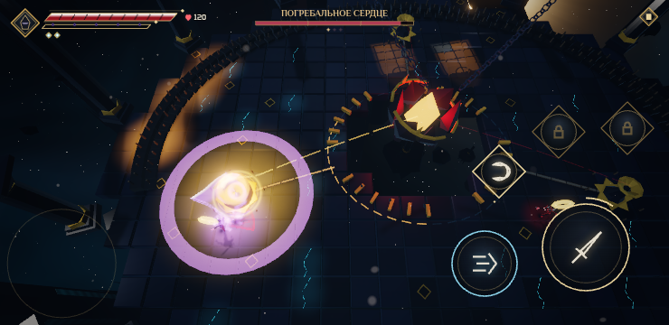

# Чертог Последнего Огня

1-4 теперь состоит из двух соединённых помещений. В Притворе Угасших остаются четыре волны и финальный элитный голем. За его северными воротами находится Чертог Последнего Огня с отдельным боссом — Погребальным сердцем. Это продолжение того же мира: герой идёт сам, камера сохраняется, экран загрузки не появляется.

Боевая площадка сердца — эллипс 38×30 м вместо прежних 27×21 м: площадь увеличена примерно вдвое. В центре остаётся колодец 10×8 м, вокруг него — свободное кольцо для боя и три разнесённые жаровни. Путь из Притвора проходит через физические ворота шириной 7 м. Декор и точки появления врагов учитывают активное помещение; расширение мира не переносит старые волны в дальний зал.

## Свет должен дождаться героя

После смерти последней элиты из неё вырывается свет. Первая сцена длится 2.4 с: камера следует за ним вверх, на 1.9 с он скрывается над местом смерти. Ворота нового зала поднимаются за 1.6 с. Дальше игрок снова управляет героем.

Скрытый свет не летит по мировому таймеру. Можно остановиться в Притворе сколько угодно: сердце остаётся спящим, враги босса не появляются, награда 1-4 не выдаётся. При физическом входе героя за порог запускается вторая сцена на 5.6 с: свет возвращается сверху, спускается в ядро на 2.3 с, звучат два сердечных удара, оболочка раскрывается, ядро разгорается. Бой начинается после окончания сцены.

Во время обеих сцен боевая симуляция остановлена, герой защищён. Полная, короткая и пропущенная версии приводят к одному состоянию. Удержание атаки, которым игрок добивал элиту, не пропускает следующую сцену автоматически: сначала нужно отпустить кнопку.


## Единая механика боя

У сердца 720 HP и три фазы. Победа требует уничтожения самого босса: три зажжённые чаши сами по себе бой не завершают. Подход к жаровне не зажигает её.

- **Огонь против хозяина.** Сердце проводит направленный удар по полу и нагревает попавшую под него чашу. Первый такой удар специально показывает связь с ближайшей жаровней. Заряженный удар клинком по нагретой чаше зажигает её на 14 с, отправляет контратаку в сердце и открывает ядро на 6 с. Контратака прерывает текущую атаку сердца и поражает врагов рядом.
- **Носильщики огня.** Из сердца к новым врагам тянутся световые нити. Одновременно живут не больше трёх носильщиков; на каждую фазу приходится не больше девяти. Их смерть оставляет золотую восковую область на 10 с. Она защищает от секторного импульса; заряженный удар расходует её на контратаку. Гибель носильщика рядом с чашей возвращает огонь и ей.
- **Возврат снарядов.** Большую летящую сферу можно отбить обычным клинком или идеальным рывком. Она меняет цвет на фиолетовый и летит к сердцу, наносит урон и открывает ядро на 4.8 с. На обратном пути сфера также может зажечь пересечённую жаровню. Сердце оставляет отдельное окно для отражения, не совмещая его с широким секторным ударом.
- **Свет как укрытие.** Горящая жаровня возвращает свечной свет своему сектору и защищает его от импульса. Огонь временный: по истечении 14 с он гаснет, а сердце может заранее вытянуть его отдельной атакой. Приходится выбирать между укрытием, контратакой и ударами по открытому ядру.
- **Доступное тело.** При открытии ядра сердце плавно опускается к кольцу вокруг колодца, чтобы его можно было достать клинком. В закрытом состоянии оболочка уменьшает прямой урон. Удары используют настоящие боевые события героя, его характеристики, критические попадания, Резонанс и ранг.

Свечи показывают состояние боя: в начале сердце забирает их свет полным кругом за 2.2 с; зажжённые чаши временно возвращают его секторам; победа освобождает весь огонь. Пламя и световые пятна действительно достигают нулевой яркости. Смена волн сама ничего не переключает.

Нагретая, но ещё не зажжённая чаша пульсирует золотым кольцом; пламя появляется только после розжига. Сенсорный автоприцел выбирает открытое ядро наравне с обычными противниками. Общий план и боевая камера проверяют, что герой, ядро и венец остаются в кадре.

На экране остаются HP босса и три отметки фаз. Отдельной памятки, счётчика искр и текстовых инструкций по механике нет: связь читается через красные атаки, нагретые чаши, золотые восковые области, фиолетовый возврат снаряда и реакцию ядра.



## Три фазы

| Фаза | Изменение сердца | Приёмы |
| --- | --- | --- |
| I, выше 2/3 HP | Шесть частей оболочки, высоко висящее ядро | Направленный удар, сфера, секторный импульс, поглощение огня |
| II, от 2/3 до 1/3 HP | Остаются четыре части оболочки, ядро опускается ниже | Две сферы и двойной импульс, более короткие паузы |
| III, ниже 1/3 HP | Две части оболочки, ядро постоянно доступно у кольца | Серии из трёх направленных линий, сферы и импульсы |

Перед ударами остаётся предупреждение не меньше 1.2 с. Переход фазы отменяет прежнюю атаку и даёт окно для удара. Только нулевые HP завершают бой, удаляют оставшиеся снаряды и носильщиков, открывают ворота и разрешают итоговую награду 1-4.


## Маршрут и мост

Награда за Врата сохраняется на мосту. После входа в Притвор мост распадается по десяти рядам за 2.5 с: падают настоящие плиты, перила и опоры. Герой сохраняет управление, камера показывает обвал, первые враги ждут его окончания. Пропасть остаётся после победы, навигация учитывает её, свечи упавших опор больше не загораются. Удалённая подсказка «Врата открыты. Пройди по золотым меткам» не возвращается.

## Воспроизведение и проверки

```bash
npm run check
npm run heart-story-test
npm run candles-test
npm run cathedral-test
```

Браузерным проверкам нужен установленный Chromium и предварительный `npm run build`. Быстрые входы:

- `?stage=1-3` — весь связанный маршрут;
- `?stage=1-4&wave=3` — последняя элита, побег света и проход к сердцу;
- `?stage=1-4&wave=4` — подход к порогу нового зала и босс;
- `&god` — бессмертие для исследования механики.

На 5 ноября 2026 проверены TypeScript, 503 модульных теста в 56 файлах и production build. `heart-story-test` на medium 844×390 выполнил 118 проверок: настоящее убийство элиты, скрытый свет при ожидании 20 с, физический проход, остановка мира во время сцен, точное поглощение и отсутствие ранней награды. `candles-test` на high 740×360 победил сердце обычными командами движения, прицеливания и атаки: три контратаки, два возврата снаряда, 26 попаданий по телу, шесть появившихся носильщиков, все три фазы и одна сохранённая победа. В сценарии полного маршрута подтверждены непрерывность мира и камеры, промежуточная награда Врат, победа над сердцем и постоянный разрыв моста.

| Проверка | Максимум draw calls | Максимум треугольников |
| --- | --- | --- |
| Сюжет, medium 844×390 | 59 | 93 799 |
| Бой, high 740×360 | 75 | 105 369 |
| Полный маршрут, medium 844×390 | 85 | 164 151 |
| Бюджет | 160 | 260 000 |

Результаты — в [heart/validation.json](heart/validation.json). Стенд использует Chromium / SwiftShader, ручной шаг 1/60 с и отключённое аудио. Убийство элиты и носильщиков ускорено для проверки состояний; HP сердца снимаются реальными боевыми событиями. Это проверка механик и сохранений, а не измерение баланса, звука, времени кадра или нагрева физических телефонов.
