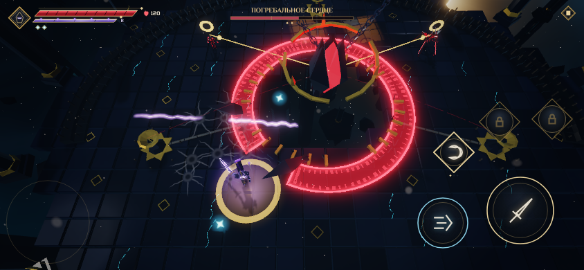

# Чертог Последнего Огня

1-4 теперь состоит из двух соединённых помещений. В Притворе Угасших остаются четыре волны и финальный элитный голем. За его северными воротами находится Чертог Последнего Огня с отдельным боссом — Погребальным сердцем. Это продолжение того же мира: герой идёт сам, камера сохраняется, экран загрузки не появляется.

Боевая площадка сердца — эллипс 38×30 м вместо прежних 27×21 м: площадь увеличена примерно вдвое. В центре остаётся колодец 10×8 м, вокруг него — свободное кольцо для боя и три разнесённые жаровни. Путь из Притвора проходит через физические ворота шириной 7 м. Декор и точки появления врагов учитывают активное помещение; расширение мира не переносит старые волны в дальний зал.

## Свет должен дождаться героя

После смерти последней элиты из неё вырывается свет. Первая сцена длится 2.4 с: камера следует за ним вверх, на 1.9 с он скрывается над местом смерти. Ворота нового зала поднимаются за 1.6 с. Дальше игрок снова управляет героем.

Скрытый свет не летит по мировому таймеру. Можно остановиться в Притворе сколько угодно: сердце остаётся спящим, враги босса не появляются, награда 1-4 не выдаётся. При физическом входе героя за порог запускается вторая сцена на 5.6 с: свет возвращается сверху, спускается в ядро на 2.3 с, звучат два сердечных удара, оболочка раскрывается, ядро разгорается. Бой начинается после окончания сцены.

Во время обеих сцен боевая симуляция остановлена, герой защищён. Полная, короткая и пропущенная версии приводят к одному состоянию. Удержание атаки, которым игрок добивал элиту, не пропускает следующую сцену автоматически: сначала нужно отпустить кнопку.


## Бой: один язык

У сердца 1350 HP и три фазы. Победа — только нулевые HP самого сердца. Весь бой держится на одном правиле, которое видно без подсказок: **ядро открыто, только когда сердце лежит на полу**. В воздухе броня гасит клинок: искры, звон металла и почти нулевой урон (12 %).


Сердце оказывается на полу тремя способами:

- **Своё падение мимо героя.** Главный приём. Сердце поднимается и встаёт над героем: на полу под ним ползёт тёмная тень. Затем оно фиксирует точку — тень густеет, вокруг неё красное кольцо, от сердца к полу тянется столб — и через 1.2–1.65 с падает туда. Кто остался под ним, теряет 30 % HP. Промахнувшись, сердце лежит с раскрытыми лепестками брони 2.4–3 с. Ядро горит золотом, из него поднимаются искры, сердце бьётся громко и часто. Пол вокруг дрожит, летят обломки.
- **Отбитая сфера.** Большую сферу отбивает обычный взмах клинка или идеальный рывок. Она становится фиолетовой, как всё, что принадлежит Пилоту, бьёт в сердце и сбивает его на кольцо в сторону героя.
- **Огонь, возвращённый в чашу.** Падение рядом с жаровней раскаляет её: золотое кольцо у основания пульсирует. Любой удар клинком по раскалённой чаше зажигает её; заряженный бьёт сильнее. Огонь копьём летит в сердце и сбрасывает его на кольцо в сторону чаши. Чашу зажигает и отбитая сфера, пролетевшая через неё, и носильщик, павший рядом.


Последние 1.25 с лежащее сердце закрывает лепестки, вокруг него появляется красный круг: встающее сердце отбрасывает тех, кто остался под ним. Жадность наказывается, но метка видна заранее.

Остальные приёмы:

- **Тёмная волна.** Кольцо идёт из колодца по всему залу. Горящая чаша и воск павшего носильщика прорезают в волне проход: стоящий за светом цел. Проходы видны на метке до выхода волны. Через саму волну можно пройти рывком.


- **Маятник.** Лучи от сердца ложатся по кругу один за другим, каждый предупреждён не меньше чем за 1.2 с. В III фазе — два встречных луча.
- **Поглощение огня.** Сердце тянет огонь горящей чаши (белая метка) и гасит её.
- **Носильщики.** Вместе живут не больше трёх, на фазу — не больше девяти. Выходят между чашами: чтобы их огонь вернулся в чашу, их надо туда привести. Восковая область держится 10 с. Она укрывает от волны, а заряженный удар по ней обжигает сердце огнём, но на пол не сбивает.

**Смена фазы — ярость, а не подарок.** Одна серия ударов не перепрыгивает фазу: HP останавливаются на пороге. Сердце поднимается над колодцем и неуязвимо 2.4 с. Время на миг вязнет, зал заливает багровым, пластины брони срываются и падают к кромке колодца: по полу видно, сколько осталось. После ярости ядро закрыто. Старая версия открывала его на 6.5 с при каждой смене фазы, а в III фазе держала открытым всё время.


**Гибель.** На нулевых HP все угрозы исчезают. Ядро сжимается и дрожит 1.9 с, мир замедляется, затем ядро лопается: белая вспышка, золотая волна по всему залу. Огонь возвращается свечам волной от места гибели, после этого бой заканчивается.

Сенсорный автоприцел выбирает ядро, только когда оно открыто. На экране остаются HP сердца и три отметки фаз. Текстовых памяток нет: правила читаются по тени, золотому свету, звону брони и проходам в волне.

## Три фазы

| Фаза | Сердце | Приёмы | Окно у пола |
| --- | --- | --- | --- |
| I, выше 2/3 HP | Шесть пластин, висит высоко | Падение (первое — медленнее), сфера, волна, поглощение | 3.0 с после падения, 2.7 после сферы, 3.2 после огня |
| II, от 2/3 до 1/3 | Четыре пластины | Падение с ударной волной от места удара, веер из трёх сфер, маятник, двойная волна | 2.7 / 2.4 / 2.9 с |
| III, ниже 1/3 | Две пластины | Серия из трёх падений (лежит после третьего), два залпа сфер, два встречных луча, двойная волна | 2.4 / 2.2 / 2.6 с |

Предупреждение перед каждым ударом — не меньше 1.2 с. Урон по герою: падение 30 % HP, волна 22 %, сфера 15 %, луч и поглощение 14 %, подъём и ударная волна падения 12 %.


## Маршрут и мост

Награда за Врата сохраняется на мосту. После входа в Притвор мост распадается по десяти рядам за 2.5 с: падают настоящие плиты, перила и опоры. Герой сохраняет управление, камера показывает обвал, первые враги ждут его окончания. Пропасть остаётся после победы, навигация учитывает её, свечи упавших опор больше не загораются. Удалённая подсказка «Врата открыты. Пройди по золотым меткам» не возвращается.

## Воспроизведение и проверки

```bash
npm run check
npm run heart-story-test
npm run candles-test
npm run cathedral-test
```

Браузерным проверкам нужен установленный Chromium и предварительный `npm run build`. Быстрые входы:

- `?stage=1-3` — весь связанный маршрут;
- `?stage=1-4&wave=3` — последняя элита, побег света и проход к сердцу;
- `?stage=1-4&wave=4` — подход к порогу нового зала и босс;
- `&god` — бессмертие для исследования механики.

```bash
npm run heart-balance
```

`heart-balance` проверяет баланс без бессмертия. Наивный игрок идёт к ближайшей цели и жмёт атаку, меток не видит. Он должен проиграть. Бот `heartBot` уходит из-под падения и из круга подъёма, бьёт лежащее ядро, отбивает сферы, зажигает раскалённые чаши и встаёт в проходы волны. Он должен победить.

Замер 5 ноября 2026, medium 844×390:

| Игрок | Итог | Длительность | Осталось |
| --- | --- | --- | --- |
| Старая версия, наивный | победа | 21 с | герой 106 из 120 HP |
| Старая версия, с механиками (бессмертие) | победа | 19.5 с | — |
| Наивный | поражение | 25 с | сердце 897 из 1350 HP |
| С механиками | победа | 79 с | герой 88 из 120 HP |

Победивший бот 9 раз увернулся от падения и бил лежащее ядро, отбивал сферы и возвращал огонь в чаши. Модульные тесты: 508 в 56 файлах, сборка 1.90 МБ при бюджете 2 МБ. На итоговой сборке прошли все браузерные проверки CI: smoke, gate-path, cathedral, heart-story, candles (medium и high), finishers, choir, studio-test.

| Проверка | Максимум draw calls | Максимум треугольников |
| --- | --- | --- |
| Сюжет, medium 844×390 | 59 | 93 799 |
| Бой, medium 844×390 | 78 | 106 665 |
| Бой, high 844×390 | 84 | 115 983 |
| Полный маршрут, medium 844×390 | 88 | 166 407 |
| Бюджет | 160 | 260 000 |

Результаты — в [heart/validation.json](heart/validation.json). Стенд использует Chromium / SwiftShader, ручной шаг 1/60 с и отключённое аудио. В `candles-test` убийство элиты и носильщиков ускорено для проверки состояний; HP сердца снимаются реальными боевыми событиями. `heart-balance` ничего не ускоряет. Боты — грубая модель игрока: реакция у них идеальная, ошибок нет. Звук, время кадра и нагрев физических телефонов здесь не измерялись.
