# Чертог Последнего Огня

Чертог — это два этапа в одном мире.

- **1-4 «Чертог Последнего Огня».** Четыре волны в Притворе Угасших и финальный элитный голем. Этап заканчивается сценой: свет павшей элиты летит в Сердце за северными воротами и будит его. Затем кадр победы и награда.
- **1-4 II «Погребальное сердце».** Отдельный бой с боссом. Этап начинается вступлением в самом Чертоге: Сердце поднимается из колодца, ревёт, над чашами собираются жернова. Ступень сложности и награда — как у 1-4. На карте этап стоит между 1-4 и 1-5. Номера, сложность и сохранения остальных этапов не меняются: кто уже проходил 1-5, сохраняет к нему доступ.

Боевая площадка сердца — эллипс 38×30 м вместо прежних 27×21 м: площадь увеличена примерно вдвое. В центре остаётся колодец 10×8 м, вокруг него — свободное кольцо для боя и три разнесённые жаровни. Путь из Притвора проходит через физические ворота шириной 7 м. Декор и точки появления врагов учитывают активное помещение; расширение мира не переносит старые волны в дальний зал.

## Свет летит к Сердцу

Последняя элита рассыпается, и через полсекунды из её груди вырывается свет. Это не шар, а огненный дух: раскалённое белое ядро в золотой оболочке, языки пламени и два машущих крыла, отогнутые по ходу полёта, нимб поперёк пути, две перекрещенные ленты шлейфа и искры.

Свет не взлетает вверх. Он разворачивается к северным воротам и летит низко над полом, облетая колонны Притвора. Ворота начинают подниматься до того, как он к ним долетит: на пролёте они открыты больше чем наполовину. Дальше свет проходит по оси прохода, над полом Чертога, и входит в ядро. Камера идёт за ним следом. Время каждого плана выводится из маршрута света, поэтому кадр совпадает с полётом при любом месте гибели элиты. Полёт длится 2–4 с.

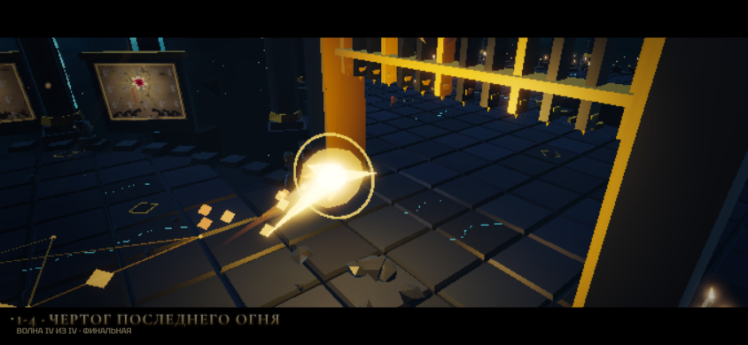

Приняв свет, Сердце тлеет: лепестки брони приоткрыты, ядро светится золотом, вокруг поднимаются искры. Финальный план показывает героя у открытых ворот. Это конец этапа 1-4: дальше кадр победы и награда.

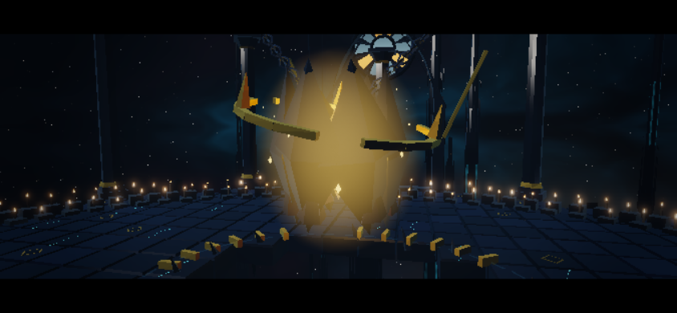

## Вступление: Сердце просыпается

Этап 1-4 II начинается сценой на 9 с.

1. Обзор из-за Сердца на вход: Сердце тлеет золотом в колодце.
2. Герой входит в Чертог, камера идёт низко за его спиной.
3. Сердце поднимается из колодца. Два тяжёлых удара.
4. Рёв: броня распахивается, золото ядра наливается багровым, по полу идёт ударная волна.
5. Над чашами собираются три жернова, к Сердцу тянутся артерии, вокруг Сердца загорается щит.
6. Общий план героя и босса с именем «Погребальное сердце — Страж Последнего Огня». Ворота за спиной героя закрываются, начинается бой.

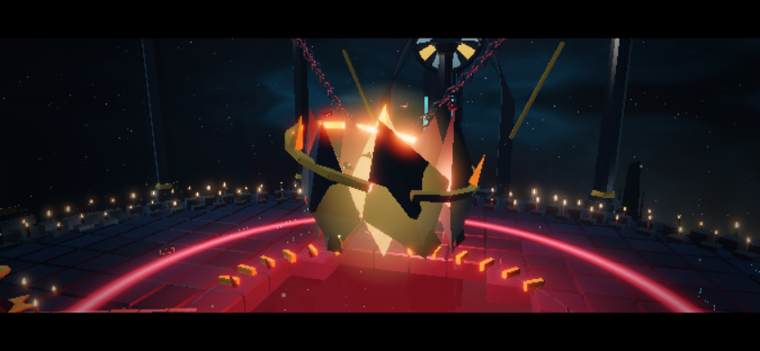

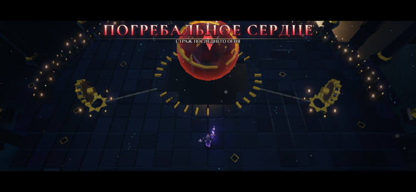

Во время сцен боевая симуляция остановлена, герой защищён. Полная, короткая и пропущенная версии приводят к одному состоянию. Удержание атаки, которым игрок добивал элиту, не пропускает следующую сцену автоматически: сначала нужно отпустить кнопку.

## Бой: два правила

У сердца 2400 HP и три фазы. Победа — только нулевые HP самого сердца. Весь бой держится на двух правилах, которые видны без подсказок.

1. **Ядро открыто, только когда сердце лежит на полу.** В воздухе броня гасит клинок: искры, звон металла и почти нулевой урон (12 %).
2. **Тьма бьёт, золото укрывает.** Всё тёмное и багровое — удар сердца. Всё золотое — огонь чаши разбитого жернова, золотые купола — укрытие.

Есть и третье, его видно по артериям: **жернова питают Сердце, их надо разбить.**

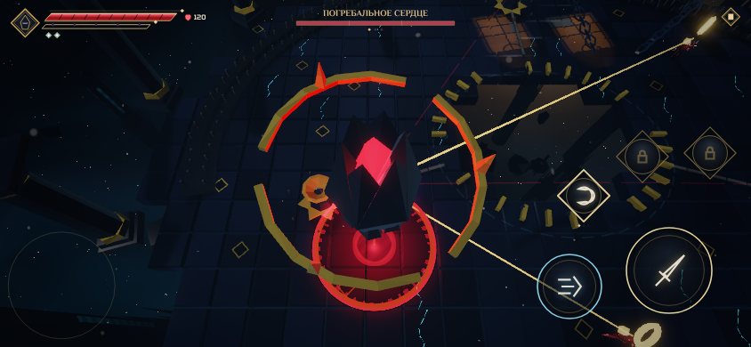

Сердце оказывается на полу тремя способами:

- **Своё падение мимо героя.** Главный приём. Сердце поднимается и встаёт над героем: на полу под ним ползёт тёмная тень. Затем оно фиксирует точку — тень густеет, вокруг неё красное кольцо, от сердца к полу тянется столб — и через 1.2–1.65 с падает туда. Кто остался под ним, теряет 30 % HP. Промахнувшись, сердце лежит с раскрытыми лепестками брони 2.4–3 с. Ядро горит золотом, из него поднимаются искры, сердце бьётся громко и часто.
- **Отбитая сфера.** Большую сферу отбивает обычный взмах клинка или идеальный рывок. Она становится фиолетовой, бьёт в сердце и сбивает его на кольцо в сторону героя.
- **Разбитый жернов.** Порванная артерия бьёт в сердце: 60 урона, и оно падает на кольцо в сторону жернова.

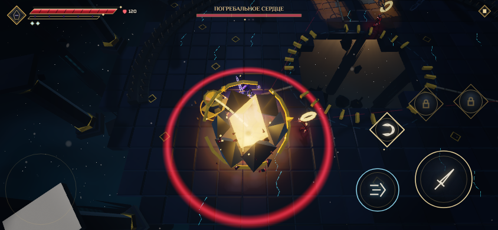

Последние 1.25 с лежащее сердце закрывает лепестки, вокруг него появляется красный круг: встающее сердце отбрасывает тех, кто остался под ним.

## Жернова

Прежний розжиг чаш убран: цепочку «падение раскаляет чашу — удар зажигает» не находили без подсказки. Вместо неё над каждой из трёх чаш висит **жернов** — каменное колесо с золотыми зубьями и тлеющей ступицей. Он медленно вращается и соединён с Сердцем артерией, по которой бежит багровый ток.

Жернова — усилители Сердца:

- **Щит.** Пока жернова целы, вокруг Сердца горит багровая оболочка. Раскрытое ядро принимает от клинка 50 % урона при трёх целых жерновах, 65 % при двух, 80 % при одном. Удар в щит отзывается багровой рябью и высоким звоном. Без жерновов — полный урон.
- **Диски.** Раз в 9 с (II фаза — 7.5 с, III — 6 с) каждый целый жернов раскручивается: ступица белеет, артерия наливается золотом, к герою ложится дорожка. Через 1.2 с жернов бросает каменный диск, и тот катится по полу. Диск снимает 13 % HP. Уйти можно в сторону или рывком сквозь диск.

Жернов принимает клинок и способности: от каждого удара летят искры и крошка, глубже проступают светящиеся трещины. Прочность — 110 / 130 / 150 по фазам: 6–8 обычных ударов или 2–3 заряженных. Разбитый жернов разлетается, его артерия рвётся и сбивает Сердце на пол. Огонь возвращается в чашу: сектор свечей снова светел, а горящая чаша прорезает проход в тёмной волне. В начале каждой фазы Сердце собирает все жернова заново.

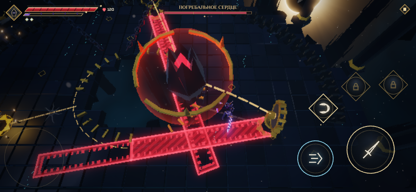

## Огненосцы и золотые купола

Прежний «воск носильщиков» убран. Заряженный удар по воску больше не обжигал сердце понятным образом, а метки над врагами ничего не объясняли.

Теперь сердце выпускает **огненосцев** — шелуху с живым пламенем над головой: золотой язык с белым ядром и свет вокруг. В тёмном зале это движущиеся огни. Павший огненосец отдаёт пламя полу. Оно поднимается **золотым куполом** радиусом 2.4 м и держится 12 с.

Купол укрывает от двух ударов. Он прорезает проход в тёмной волне, и только он спасает от Погребального прилива. В I фазе огненосцев нет: бой учит первому правилу. Со II фазы они приходят по одному, живых вне прилива — не больше двух.

## Погребальный прилив

Это удар по всему залу. Он открывает II и III фазы и ещё раз приходит в середине III.

1. Сердце ревёт и поднимается высоко над колодцем, недосягаемое для клинка. Все чаши гаснут, жар уходит.
2. Сердце само выпускает трёх огненосцев на равных долях круга. Ближний выходит в стороне от героя.
3. Из колодца по полу разливается тьма — тёмная вода с багровыми прожилками и яркой пеной на фронте. Камера отступает, чтобы были видны огненосцы и купола. За 5.0 с (II фаза) или 4.3 с (III) тьма доходит до стен.
4. Вдох 0.75 с: прожилки бьются, сердце набирает силу.
5. Три удара прилива через 0.45 с. Кто вне купола, теряет по 20 % HP; рывком все три не пережить. Огненосцев, не успевших отдать свет, тьма поглощает без купола.

Под куполом слышен только золотой звон. Решение одно и видно сразу: срубить огненосца и встать в его свет.

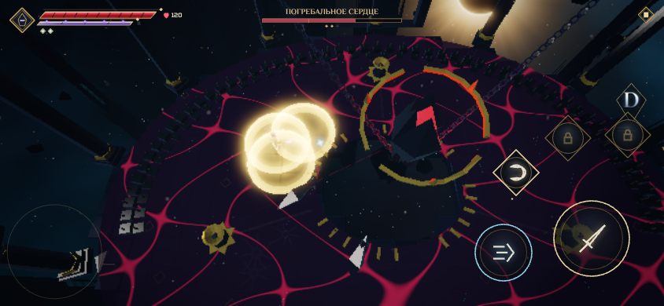

## Остальные приёмы

- **Тёмная волна.** Кольцо идёт из колодца по всему залу. Горящая чаша и золотой купол прорезают в волне проход, который виден на метке до выхода волны. Через саму волну можно пройти рывком.
- **Веер копий («маятник»).** Лучи-метки ложатся по кругу один за другим, каждый предупреждён не меньше чем за 1.2 с. По каждому из Сердца вылетает багровое копьё и оставляет гаснущий след. В I фазе — пять копий, во II — семь, в III — два встречных веера по восемь.
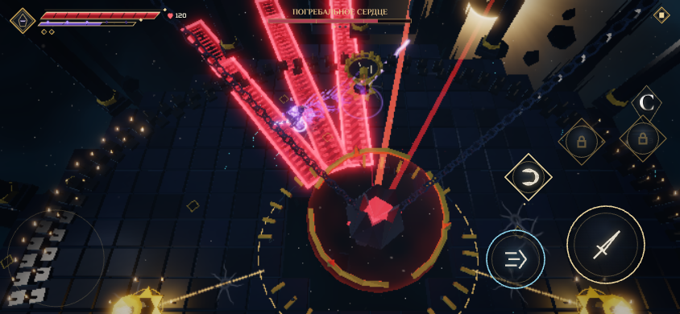

- **Веер сфер.** С I фазы Сердце бросает три большие сферы веером, в III фазе — два залпа. Любую можно отбить клинком или идеальным рывком.
- **Восковой дождь** (II и III фазы). Капли воска ложатся одна за другой: первая — туда, где герой стоит, следующие — туда, куда он бежит. Каждая предупреждена 1.2 с, падающая капля видна над меткой. Во II фазе капель 8, в III — 12. Стоять нельзя: нужно двигаться.
- **Эхо падений** (III фаза). Серия из трёх падений оставляет на местах первых двух ударов тень, и через 1.3 с она бьёт ещё раз. Пол помнит каждое падение. У последнего падения, после которого сердце лежит открытым, эха нет: окно для удара не отнимается.

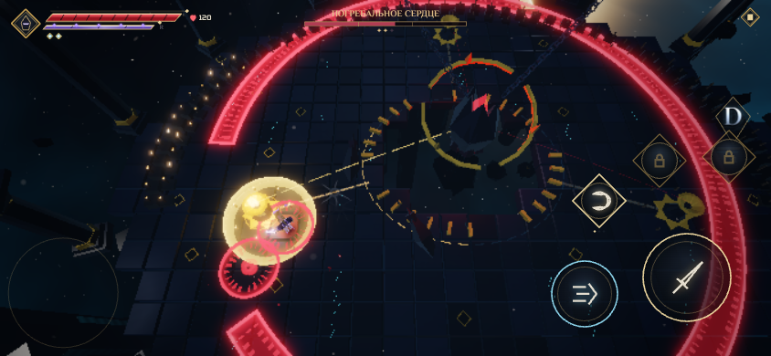

## Фазы, ярость и гибель

**Смена фазы — ярость, а не подарок.** Одна серия ударов не перепрыгивает фазу: HP останавливаются на пороге. Сердце неуязвимо 2.4 с, время на миг вязнет, зал заливает багровым, пластины брони срываются и падают к кромке колодца. Жернова собираются заново. Сразу за яростью начинается прилив.

**Дальние приёмы — чаще, падение — реже.** На цикл фазы — два падения против трёх раньше. Остальное время занимают сферы, веер копий, дождь и диски жерновов.

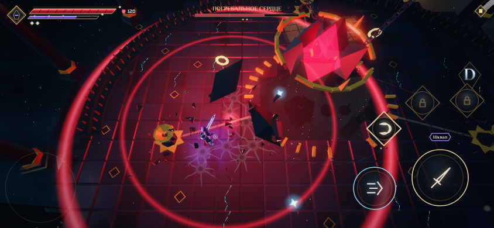

| Фаза | Сердце | Приёмы | Окно у пола |
| --- | --- | --- | --- |
| I, выше 2/3 HP | Шесть пластин, висит высоко | Три веера сфер, два падения (первое — медленнее), веер из пяти копий, волна; диски жерновов раз в 9 с | 3.0 с после падения, 2.7 после сферы, 3.2 после жернова |
| II, от 2/3 до 1/3 | Четыре пластины | Прилив в начале. Три веера сфер, два падения с ударной волной, два веера копий, восковой дождь, двойная волна, огненосцы; диски раз в 7.5 с | 2.7 / 2.4 / 2.9 с |
| III, ниже 1/3 | Две пластины | Прилив в начале и в середине цикла. Три двойных веера сфер, две серии из трёх падений с эхом, два встречных веера копий, дождь из 12 капель, двойная волна; диски раз в 6 с | 2.4 / 2.2 / 2.6 с |

Предупреждение перед каждым ударом — не меньше 1.2 с. Урон по герою: падение 30 % HP, волна 22 %, каждый удар прилива 20 %, сфера 15 %, эхо 15 %, копьё веера 14 %, диск жернова 13 %, капля 12 %, подъём и ударная волна падения 12 %.

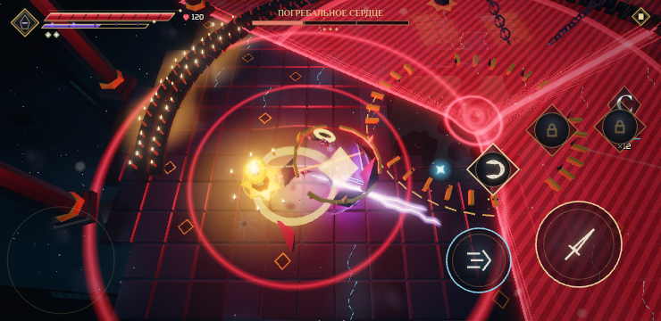

**Гибель — отдельная сцена на 8.5 с.** Сама гибель идёт на 20 % медленнее прежней (вспышка на 2.3 с вместо 1.9 с): моменту нужен вес. Кадр победы — прежней длины.

1. На нулевых HP все угрозы исчезают, мир останавливается.
2. Крупный план: удары сердца затихают, из трещин ядра бьют и растут лучи света, ядро сжимается и дрожит. Каждый из двух последних ударов (0.84 и 1.74 с) со звоном срывает пластину брони. Пластина ложится у кромки колодца, и к вспышке на ядре брони не остаётся.
3. Через 2.28 с ядро лопается: белая вспышка, золотая волна, камеру отбрасывает. Обруч-астролябия рвётся на звенья и шипы. Сорванные пластины трескаются у кромки колодца, когда до них доходит волна. Куски падают на пол или в колодец и за 2.6 с рассыпаются золотыми искрами и пеплом. К кадру победы от Сердца остаётся только колодец; пропущенная сцена даёт то же самое.
4. Из лопнувшего ядра поднимается освобождённый свет — тот же огненный дух, что пришёл из элиты. Камера снизу провожает его к своду, а золотая волна возвращает огонь всем свечам.
5. Поза победы героя и титул «Сердце угасло».

Награда идёт сразу после сцены. Её можно пропустить удержанием атаки, итог тот же.

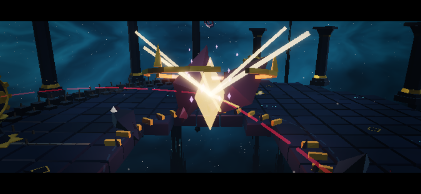

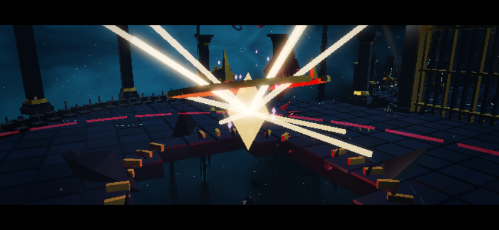

| Вспышка: обруч и броня разлетаются | Через 1.1 с: куски рассыпаются | Через 2.1 с: остался колодец |
| --- | --- | --- |
| 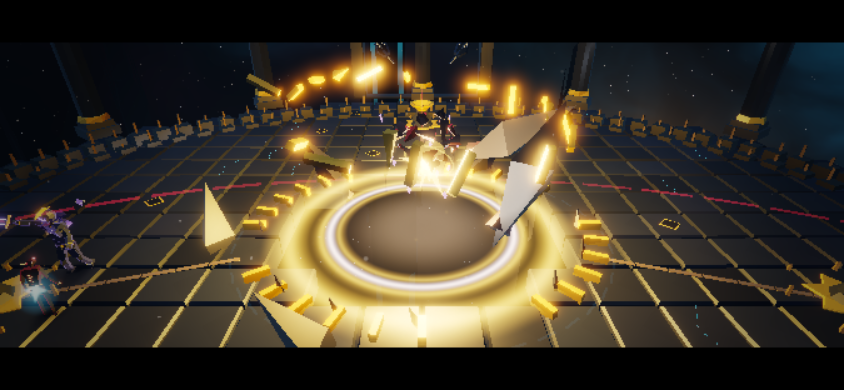 | 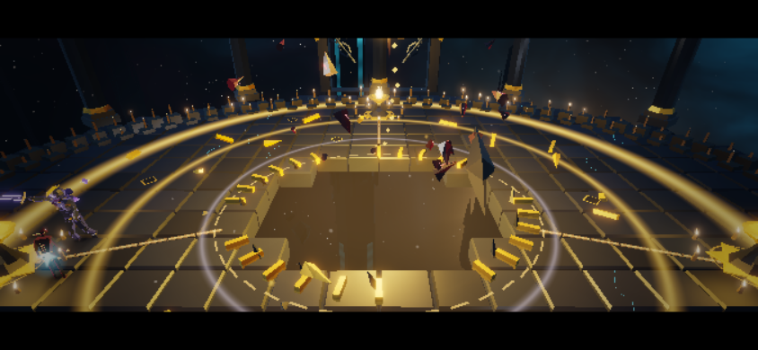 | 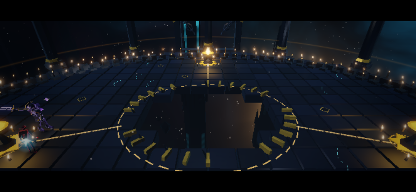 |

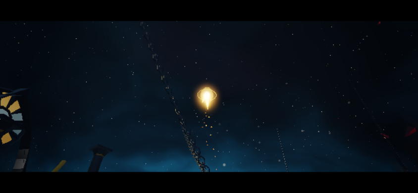

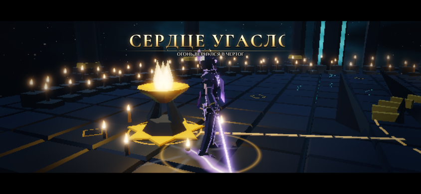

Сенсорный автоприцел выбирает ядро, только когда оно открыто; огненосцы — обычные цели. На экране остаются HP сердца и три отметки фаз. Текстовых памяток нет: правила читаются по тени, золотому свету, звону брони, пламени огненосцев и проходам в волне.

## Маршрут и мост

Награда за Врата сохраняется на мосту. После входа в Притвор мост распадается по десяти рядам за 2.5 с: падают настоящие плиты, перила и опоры. Герой сохраняет управление, камера показывает обвал, первые враги ждут его окончания. Пропасть остаётся после победы, навигация учитывает её, свечи упавших опор больше не загораются. Удалённая подсказка «Врата открыты. Пройди по золотым меткам» не возвращается.

## Воспроизведение и проверки

```bash
npm run check
npm run heart-story-test
npm run candles-test
npm run cathedral-test
```

Браузерным проверкам нужен установленный Chromium и предварительный `npm run build`. Быстрые входы:

- `?stage=1-3` — весь связанный маршрут;
- `?stage=1-4&wave=3` — последняя элита и полёт света в Сердце, конец этапа 1-4;
- `?stage=1-4b` — бой с Сердцем со вступлением;
- `&god` — бессмертие для исследования механики.

```bash
npm run heart-balance
```

`heart-balance` проверяет баланс без бессмертия. Наивный игрок идёт к ближайшей цели и жмёт атаку, меток не видит. Он должен проиграть. Бот `heartBot` уходит из-под падения и из круга подъёма, бьёт лежащее ядро, отбивает сферы, разбивает жернова, уходит с дорожек дисков, встаёт в проходы волны, а в приливе рубит огненосца и стоит под его куполом. Он должен победить.

Замер 5 ноября 2026, medium 844×390:

| Игрок | Итог | Длительность | Осталось |
| --- | --- | --- | --- |
| Первая версия (720 HP), наивный | победа | 21 с | герой 106 из 120 HP |
| Вторая версия (1350 HP), наивный | поражение | 25 с | сердце 897 из 1350 HP |
| Вторая версия (1350 HP), с механиками | победа | 79 с | герой 88 из 120 HP |
| Наивный | поражение | 29 с | сердце 1805 из 2400 HP |
| С механиками | победа | 197 с: I фаза 45 с, II 69 с, III 83 с | герой 94 из 120 HP |

Случайность в `heart-balance` не засеяна, поэтому бот с механиками от прогона к прогону ведёт бой по-разному. Наивный игрок проигрывает одинаково: 29.1 с, у сердца 1805 HP. Пять прогонов бота с механиками после отзыва о трещинах (симуляция боя в нём не менялась):

- три на новой сборке: победы за 188–207 с, у героя осталось 15–68 из 120 HP;
- два на прежней: победа за 193 с с 46 HP и одно поражение на 190-й секунде.

Ещё четыре прогона после пятого захода и правок нагрева: победы за 198 и 192 с (у героя 2 и 34 HP) и два поражения на 173-й и 211-й секунде, когда у сердца оставалось 150 и 167 HP. Правки нагрева симуляцию не трогают: стенд шагает боем напрямую, мимо темпа кадров. Всего из девяти прогонов бот с механиками проиграл три.

Строка выше — один удачный прогон. Значит, даже идеальная реакция не гарантирует победу: человеку бой будет заметно тяжелее, чем показывает таблица.

Победивший бот:

- разбил 8 жерновов;
- 23 раза отбил сферу;
- увернулся от 9 падений — их вдвое меньше, чем раньше, — и бил лежащее ядро;
- ушёл с дорожек 20 дисков;
- все 9 ударов трёх приливов пережил под куполами.

Наивный игрок получал урон от падения, сфер, копий веера и волны. Жерновов он не разбил ни одного, поэтому все его удары по раскрытому ядру уходили в щит.

Модульные тесты: 535 в 56 файлах, сборка 1.94 МБ при бюджете 2 МБ. На итоговой сборке прошли все браузерные проверки CI: smoke, gate-path (844×390 и 740×360), cathedral, heart-story (844×390 и 740×360), candles (medium и high), finishers, choir, studio-test.

| Проверка | Максимум draw calls | Максимум треугольников |
| --- | --- | --- |
| Сюжет (1-4 и вступление 1-4 II), medium 844×390 | 58 | 90 619 |
| Бой, medium 844×390 | 78 | 103 615 |
| Бой, high 844×390 | 89 | 113 389 |
| Полный маршрут, medium 844×390 | 83 | 164 145 |
| Бюджет | 160 | 260 000 |

Результаты — в [heart/validation.json](heart/validation.json). Стенд использует Chromium / SwiftShader, ручной шаг 1/60 с и отключённое аудио. В `candles-test` (этап 1-4 II) огненосцы, прожившие 4 с, гибнут ускоренно: проверяется их купол, а не трудность боя с ними. HP сердца снимаются реальными боевыми событиями. `heart-balance` ничего не ускоряет. Боты — грубая модель игрока: реакция у них идеальная, ошибок нет, поэтому человек будет терять больше HP и драться дольше. Звук, время кадра и нагрев физических телефонов здесь не измерялись.
