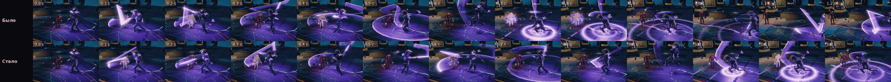
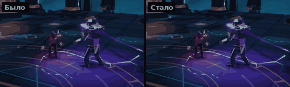

# Темп Пилота: удары и комбо медленнее и читаемее

Отзыв: игра слишком резкая и быстрая, атаку, комбо и удары по врагам трудно разглядеть. Нужно замедлить Пилота, но
так, чтобы играть было так же приятно.

## Что было не так

- **Следующий удар серии срезал предыдущий через 0.1 с.** Окно связки открывалось почти сразу после попадания, и при
  частых нажатиях каждый новый удар обрывал проводку прошлого. Сам взмах длился 40 мс.
- **Четыре удара серии укладывались в 0.87 с:** 4.7 удара в секунду, первые три — за 0.37 с.
- **Бег 5.5 м/с, разгон 0.06 с, разворот 0.08 с** — Пилот дёргался при каждой смене направления.
- **Рывок 4.5 м за 0.18 с** почти не успевал прочитаться.

## Что сделано

Все величины — в одном месте, `HERO_PACE` в [src/data/pace.ts](../src/data/pace.ts).

| Что | Было | Стало |
| --- | --- | --- |
| Скорость приёмов клинка (клипы, окна связки и отмены в рывок) | ×1 | ×0.85 |
| Следующий удар серии — не раньше | 0.1 с от начала удара | 60 % длительности удара (проводка видна), нажатие ждёт в буфере |
| Вес удара клинка: урон, оглушение, Резонанс и очки ранга за удар | ×1 | ×1.32 |
| Бег | 5.5 м/с | 4.95 м/с |
| Разгон / остановка / разворот | 0.06 / 0.05 / 0.08 с | 0.09 / 0.08 / 0.12 с |
| Рывок (дальность та же — 4.5 м) | 0.18 с, неуязвимость 0.14 с | 0.22 с, неуязвимость 0.17 с |
| Стоп-кадр попадания клинком | ×1, не больше 0.14 с | ×1.3, не больше 0.17 с |
| Хитстан рядовых от клинка | ×1 | ×1.45 — серия по-прежнему держит их до конца |
| Клипы способностей | ×1 | ×0.9 |

**Серия той же длины в ударах, но каждый удар виден.** Если нажимать часто, удар доигрывает проводку, а следующее
нажатие ждёт в буфере ввода 0.15 с и срабатывает в момент, когда связка открывается. Нажатия не теряются.

**Баланс прежний.** Серия медленнее, поэтому каждый удар во столько же раз тяжелее. Урон в секунду, оглушение и
Резонанс в секунду почти не меняются. Ветки комбо (Шквал после паузы, Рассечение после рывка, воздушная связка)
работают как раньше: их окна растянуты вместе с темпом.

## Хронометраж серии

Манекен, нажатие каждые 100 мс (частые нажатия на телефоне).

| Удар | Было, начало | Стало, начало |
| --- | --- | --- |
| 1. Разрез | 0.02 с | 0.02 с |
| 2. Обратный разрез | 0.12 с | 0.20 с |
| 3. Вращение | 0.22 с | 0.39 с |
| 4. Нисходящий разлом (удар о пол) | 0.38 с (0.61 с) | 0.64 с (0.93 с) |
| Следующая серия | 0.88 с | 1.24 с |

| За 8 с частых нажатий (раз в 100 мс) | Было | Стало |
| --- | --- | --- |
| Ударов в секунду | 4.73 | 3.40 |
| Урон в секунду (атака 12) | 81.4 | 78.4 |
| Резонанс в секунду | 13.7 | 12.9 |

| Урон в секунду по манекену | Было | Стало |
| --- | --- | --- |
| Нажатие раз в 100 мс | 81.4 | 78.4 (−4 %) |
| Нажатие раз в 250 мс | 66.7 | 75.0 (+12 %) |

## Бои с боссами

Боты играют задуманным способом, Math.random засеян, оба темпа — на одних зёрнах.

| Бой | Темп | Побед | Время боя | HP героя в конце |
| --- | --- | --- | --- | --- |
| Погребальное сердце, бот с механиками | прежний | 4 из 4 | 188–198 с | 7–46 |
| | новый | 4 из 4 | 182–211 с | 24–70 |
| Звонарь, бот с рывками | прежний | 6 из 6 | 51–66 с | 32–90 |
| | новый | 6 из 6 | 58–76 с | 74–113 |

Бои длятся столько же или чуть дольше, героя бьют реже. Скорее всего, помогает рывок: неуязвимость стала дольше вместе
с ним. Бой со Звонарём на ~10 % длиннее: бег медленнее, и до тумб верёвок Пилот добегает позже.

## Как сравнить

- `?pace=classic` — прежний темп, без параметра — новый. Работает на любом этапе, например
  `?stage=training&pace=classic`.
- Тесты темпа — [tests/pace.test.ts](../tests/pace.test.ts): серия медленнее и не обрывает проводку, урон в секунду при
  частых нажатиях в пределах ±10 % от прежнего, рывок той же дальности и дольше, `?pace=classic` возвращает старый темп.

## Ограничения

- На телефоне темп не проверялся: кадры и замеры — стенд в браузере.
- Урон уравнен для частых нажатий. Кто нажимает реже, чем раз в ~0.18 с, упирается в свой ритм, а не в окно связки, и с
  тяжёлым ударом наносит больше урона, чем раньше: при нажатии раз в 250 мс — на 12 % больше.
- Длина клипов способностей выросла на 10 %; их эффекты (Серп, Колодец, Затмение) идут по своим часам и не изменились.
