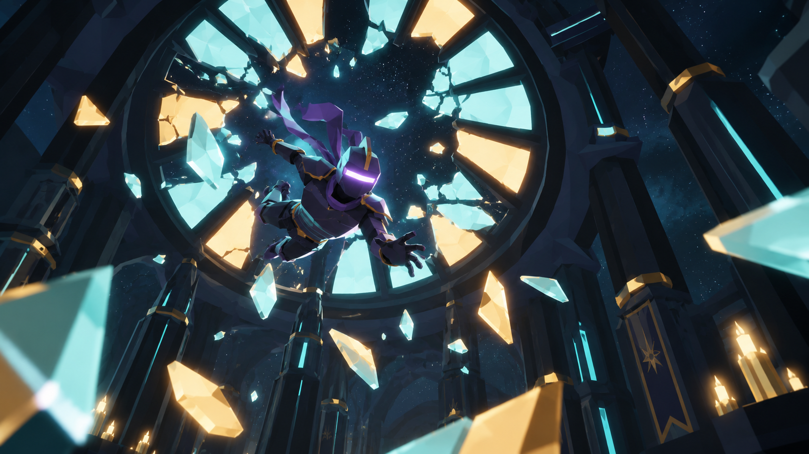
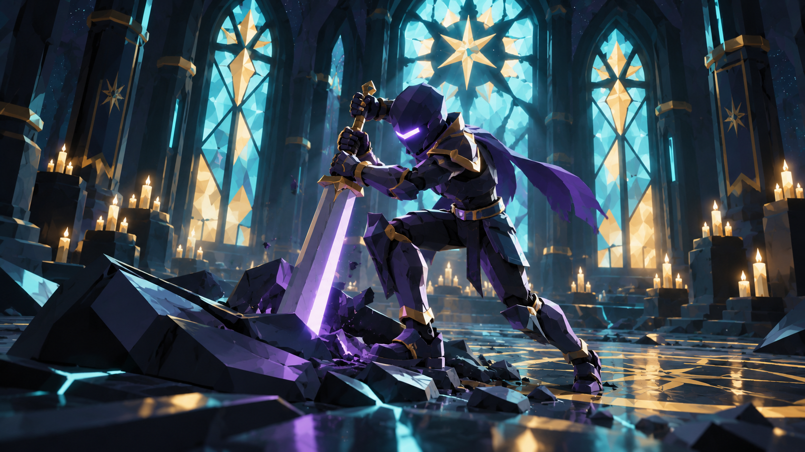
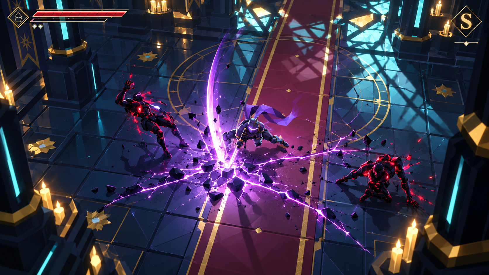
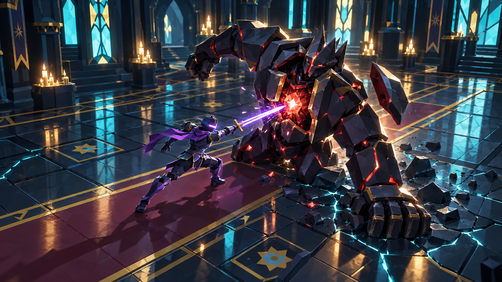
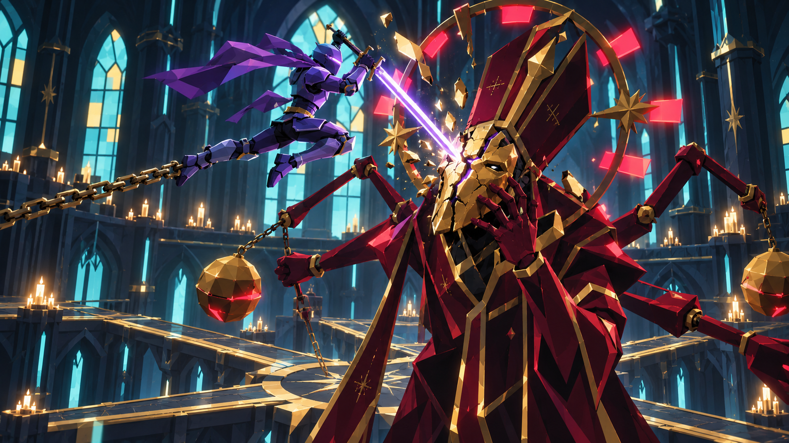
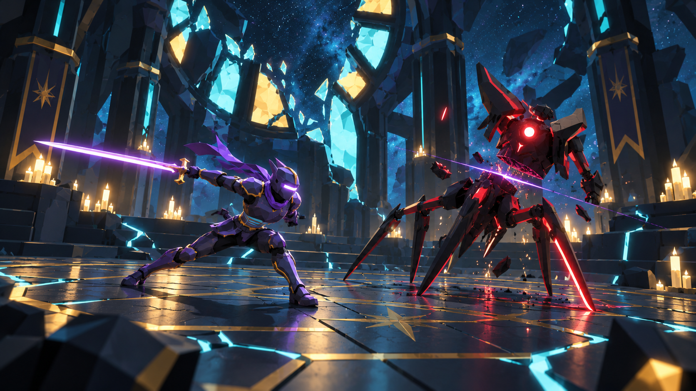
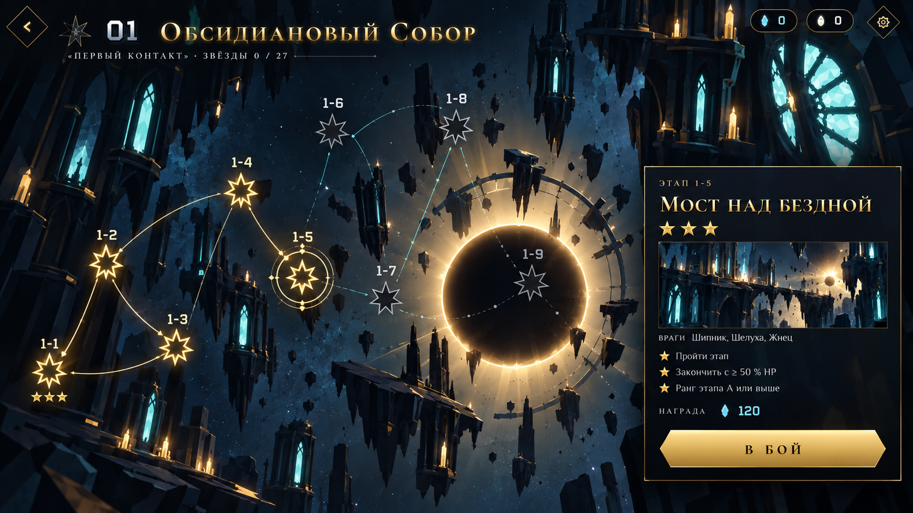
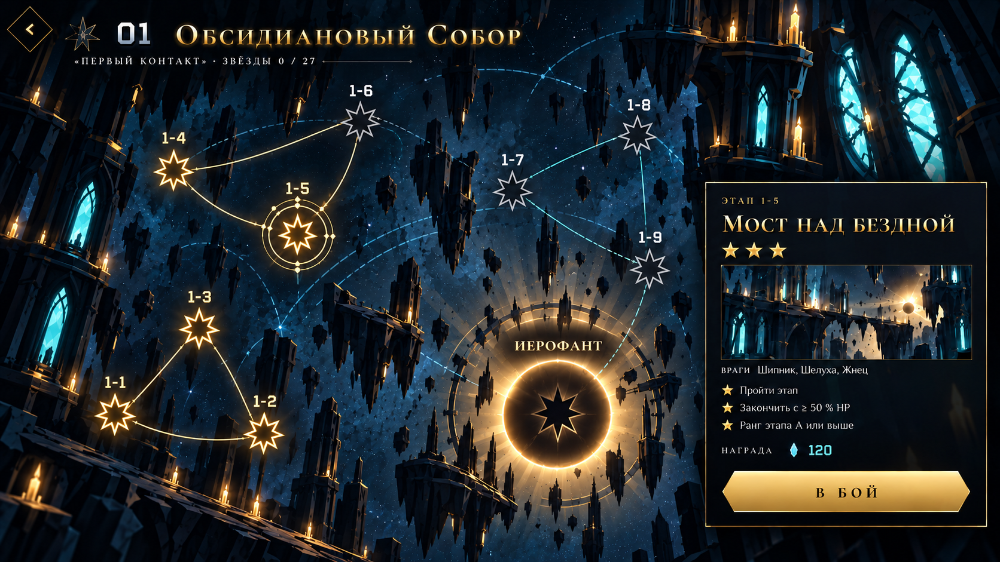

# VOIDBREAKER — визуальные референсы

Восемь сгенерированных кадров на основе скриншотов Voidbreaker: шесть сцен и два варианта карты. Это целевые ориентиры для доработки, а не кадры уже реализованных изменений.

**Папка от корня проекта:** `docs/visual-references/`. **ТЗ:** [VOIDBREAKER_Spectacle_Spec.md](../../VOIDBREAKER_Spectacle_Spec.md). [Сводная таблица путей и задач](../../VOIDBREAKER_Spectacle_Spec.md#visual-references). Все изображения — PNG, 1672×941.

| ID | Сценарий | Файл |
|---|---|---|
| R01 | Разрушение витража | [01_stained_glass.png](01_stained_glass.png) |
| R02 | Извлечение меча | [02_sword_extraction.png](02_sword_extraction.png) |
| R03 | Нисходящий разлом | [03_descending_rift.png](03_descending_rift.png) |
| R04 | Открытое ядро Голема | [04_golem_open_armor.png](04_golem_open_armor.png) |
| R05 | Казнь Иерофанта | [05_hierophant_execution.png](05_hierophant_execution.png) |
| R06 | Добивание последнего врага | [06_last_enemy_finisher.png](06_last_enemy_finisher.png) |
| R07 | Карта — атмосферный вариант | [07_constellation_atmosphere.png](07_constellation_atmosphere.png) |
| R08 | Карта — астролябия, основная композиция | [08_constellation_astrolabe.png](08_constellation_astrolabe.png) |

## Как работать с изображениями

Из кадров переносить композицию, позы, направление света, устройство поверхностей и понятность действия. Детали эмблем, надписей и HUD выполнять по исходникам игры: семиконечная звезда остаётся семиконечной. Генерация не является точным источником нумерации, связей карты, игровых размеров или баланса.

Сохранять текущую палитру и процедурное производство игровых ассетов. Пилот и его воздействие — фиолетовые, энергия врагов — багровая, окружение — бирюза, тёплый свет и золото. Количество деталей, отражения и яркость подбирать по мобильному бюджету. Изображения служат документацией, не загружаются игрой и не входят в `public/`, сборку или кэш PWA.

## R01. Разрушение витража

**Путь:** `docs/visual-references/01_stained_glass.png`. **Задача:** [пролог, §13 ТЗ](../../VOIDBREAKER_Spectacle_Spec.md#stained-glass-breach).

**Что показывает кадр.** Пилот проходит через узнаваемую розу купола; вокруг пролома остаются крупные цветные сегменты. Видно, какая поверхность разрушилась и откуда летит персонаж.

**Что перенести.** Диагональный нижний ракурс, свободное пространство вокруг силуэта, крупные фрагменты с толщиной и остатками исходного рисунка, цветные блики на броне. Контакт не закрывается сплошной вспышкой.

**До и после кадра.** Сначала целый витраж и приближение героя; затем контакт и расходящиеся трещины; после — раскрытие проёма, крупные фрагменты, мелкая крошка и продолжение падения внутрь того же собора.

**Приёмка.** После первого просмотра без субтитров понятно, что Пилот пробил потолок. Силуэт и проём видны на небольшом экране, направление падения сохраняется между планами. Неподвижный референс не заменяет анимацию первого контакта.

## R02. Извлечение меча

**Путь:** `docs/visual-references/02_sword_extraction.png`. **Задача:** [поднятие меча, §14 ТЗ](../../VOIDBREAKER_Spectacle_Spec.md#sword-extraction).

**Что показывает кадр.** Герой тянет узнаваемый клинок из обломка с заметным усилием. Хват, гарда, лезвие и опора ног видны одновременно.

**Что перенести.** Низкую устойчивую позу, помощь свободной руки, упор стопы, видимый металлический корпус оружия и умеренную светящуюся кромку. Рукоять остаётся открытой для взгляда.

**До и после кадра.** Взгляд на предмет → хват → короткое сопротивление → разрушение удерживающей опоры → извлечение по непрерывной траектории → осмотр клинка → пробуждение энергии. Обломок «Инея» должен заранее читаться как заготовка оружия.

**Приёмка.** Ладонь совпадает с рукоятью, предмет не скачет из мира в руку и не возникает из нулевого масштаба. В ключевом плане виден весь клинок. После пропуска остаётся один исправный предмет.

## R03. Нисходящий разлом

**Путь:** `docs/visual-references/03_descending_rift.png`. **Задачи:** [различимость комбо, §7](../../VOIDBREAKER_Spectacle_Spec.md#pilot-combos), эффекты удара, §8 ТЗ.

**Что показывает кадр.** Низкая поза Пилота, вертикальная траектория клинка, расходящаяся трещина пола и разные направленные реакции противников образуют одно тяжёлое действие.

**Что перенести.** Опору стоп, перенос веса через таз и плечи, ясное направление вниз, локальную точку контакта и различимый силуэт. Свечение подчиняется форме удара.

**До и после кадра.** Высокая подготовка → ускорение вниз → контакт → короткое удержание опорной позы → реакция целей и затухание следа → восстановление или допустимая отмена.

**Приёмка.** Разлом узнаваем с рабочей камеры даже без дополнительных VFX. Герой не выглядит зависшим над полом, а трещины и частицы не скрывают последующие телеграфы. Длину следа и область разрушения согласовать с игровым действием; картинка не расширяет хитбокс сама по себе.

## R04. Открытое ядро Голема

**Путь:** `docs/visual-references/04_golem_open_armor.png`. **Задача:** [раскрываемая броня, §10.1 ТЗ](../../VOIDBREAKER_Spectacle_Spec.md#golem-open-armor).

**Что показывает кадр.** Голем опирается тяжёлой рукой на пол после промаха. Грудные плиты разошлись, ядро открыто, клинок Пилота попадает в конкретное место.

**Что перенести.** Разницу массы персонажей, устройство раскрывающейся брони, давление опорной руки, локальные сколы и малый контактный импульс. Ядро врага остаётся багровым; фиолетовый свет обозначает воздействие Пилота.

**До и после кадра.** Тяжёлый замах → промах и опора рукой → раскрытие плит → короткое окно → удар и потеря пластины → восстановление Голема. Это преимущество за понятное действие, а не единственный способ победы.

**Приёмка.** Игрок узнаёт окно по телу и анимации. Масштаб изображения не задаёт обязательное увеличение в игре: вариант ×1,15 сравнивается отдельно. Коллизии, навигация, камера и точки прицеливания согласованы с итоговым размером.

## R05. Казнь Иерофанта

**Путь:** `docs/visual-references/05_hierophant_execution.png`. **Задача:** [новая постановка казни, §5 ТЗ](../../VOIDBREAKER_Spectacle_Spec.md#hierophant-execution).

**Что показывает кадр.** В одном плане одновременно видны Пилот целиком, оружие, место удара на маске и цепь, от которой он оттолкнулся. Фрагменты отделяются от поражённой части.

**Что перенести.** Понятную географию действия, диагональ прыжка, контакт на заранее видимой трещине, свободное место вокруг клинка и узнаваемость маски, нимба и рясы. Полная яркость не закрывает попадание.

**До и после кадра.** Общий план героя, маски и цепи → опора и подъём специальным клипом → прыжок → точный контакт → реакция рук и раскол маски → приземление → отложенный разрез тела → энергия к звезде.

**Приёмка.** Камера, поза и эффекты используют согласованное время. Зритель без текста понимает, куда попали, что разрушилось и почему изменился мир. Специальные клипы и точки рига важнее буквального копирования пропорций генерации.

## R06. Добивание последнего врага

**Путь:** `docs/visual-references/06_last_enemy_finisher.png`. **Задача:** [замена победного облёта, §6 ТЗ](../../VOIDBREAKER_Spectacle_Spec.md#last-enemy-finisher).

**Что показывает кадр.** Пилот завершил рез и удерживает устойчивую позу; Жнец теряет опору и разделяется по одной читаемой линии. Его тело остаётся узнаваемым в начале распада.

**Что перенести.** Направление последнего удара, движение плаща после остановки тела, опору ног и серпа, крупные фрагменты корпуса и короткую задержку раскрытия разреза. Смерть Жнеца отличается от взрыва частиц.

**До и после кадра.** Реальный летальный удар → краткий акцент камеры → потеря опоры и распад цели → затухание и переход к результатам. Для снаряда и бездны сцена следует реальному способу смерти; герой не переносится к уже убитой цели.

**Приёмка.** Смерть и награда фиксируются один раз, отложенные спауны учтены. Добивание Стража или Раскол не перекрываются второй сценой. Ориентир длительности — около секунды для рядового, до двух для тяжёлого.

## R07. Карта — атмосферный вариант

**Путь:** `docs/visual-references/07_constellation_atmosphere.png`. **Задача:** [карта и интерфейс, §15–16 ТЗ](../../VOIDBREAKER_Spectacle_Spec.md#constellation-map).

**Что показывает кадр.** Плавающие архитектурные ярусы дают глубину, золото выделяет прогресс, большая тёмная звезда создаёт центр композиции, карточка содержит образ выбранной локации.

**Что перенести.** Глубину фоновых слоёв, сочетание камня и витражей, мягкую корону звезды и различие активных/закрытых узлов. При выборе узла — короткий световой проход по связи и появление карточки.

**Ограничение варианта.** Это атмосферный эскиз. Его состав узлов и отображение босса не использовать как схему прохождения. Для композиции с девятью этапами и отдельным Иерофантом опираться на R08.

**Приёмка.** Декорации не перекрывают игровые узлы, карточка не сжимает карту до нечитаемого размера, выбранный этап различим. Игровые подписи и граф берутся из данных проекта.

## R08. Карта — астролябия

**Путь:** `docs/visual-references/08_constellation_astrolabe.png`. **Задача:** [основная композиция карты, §15 ТЗ](../../VOIDBREAKER_Spectacle_Spec.md#constellation-map).

**Что показывает кадр.** Девять этапов собраны в три разнесённые группы, а Иерофант получает самостоятельный крупный узел. Неравномерные расстояния и свободное пространство заменяют тесный одинаковый зигзаг.

**Что перенести.** Группировку, иерархию размеров, разницу состояний и отделение босса. Фоновые дуги астролябии остаются декоративными, маршрут прохождения — самостоятельным и однозначным.

**При реализации.** Состав узлов и последовательность связей вычислять из `ZONE1` и правил открытия. На генерации встречаются декоративные линии и неточности — их не переносить в игровую логику. Семиконечные эмблемы, номера и доступность рисуются существующими средствами интерфейса.

**Приёмка.** Все девять этапов и босс представлены отдельными узлами, порядок прохождения понятен. На 844×390 цели касания сохраняют размер около 44 CSS px; карточка выбранного этапа может сворачиваться вместо сжатия карты. Анимации не задерживают выбор и запуск уровня.
